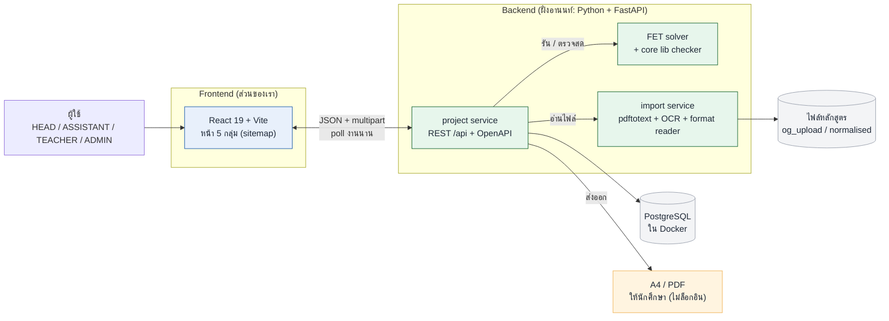

# ระบบตารางเรียนอัตโนมัติ: เอกสารสำหรับนักพัฒนา

ระบบจัดตารางเรียนสำหรับมหาวิทยาลัยไทย อ่านหลักสูตรจากไฟล์ (มคอ.2) ให้หัวหน้าภาควิชากับอาจารย์วางแผนภาคเรียนร่วมกัน แล้วสร้างตารางที่ไม่ชนกันให้พิมพ์ได้
โอเพนซอร์ส แต่ละสถาบันติดตั้งบนเซิร์ฟเวอร์ของตนเอง (self-hosted) นักศึกษาไม่ล็อกอิน

> สถานะ: ขั้นออกแบบ (ก่อนเขียนโค้ด) · ภาษา: ไทย · อัปเดต 2026-10-27

## ภาพรวมสถาปัตยกรรม



- **Frontend ไม่คุย solver ตรง ๆ** ทุกอย่างผ่าน project service ซึ่งเป็นตัวเดียวที่เขียนข้อมูลและบันทึกทุกการเปลี่ยน (N1)
- **ฟ้า** = ส่วนที่เรารับผิดชอบ · **เขียว** = ฝั่งอานนท์ · ดู [เส้น API](api.md) และ [Tech Stack](../th/8-tech-stack.md)

## ต้นฉบับกับชุดนี้

ชุดนี้เรียบเรียงใหม่จากเอกสารออกแบบขั้น 1-7 เพื่อให้นักพัฒนาใช้งานได้ ต้นฉบับยังอยู่ครบและไม่ถูกแก้:

| ต้นฉบับ | ใช้เป็นหลักฐานเมื่อ |
|---|---|
| [`doc/1-users-and-goals`](../1-users-and-goals/users-and-goals.txt), [`2-user-journeys`](../2-user-journeys/user-journeys.txt), [`3-sitemap`](../3-sitemap/sitemap.txt), [`4-user-flows`](../4-user-flows/user-flows.txt) | ต้องการรายละเอียดหรือเหตุผลเดิม (ภาษาอังกฤษ + ไทยปน) |
| [`doc/5-wireframes/prototype.html`](../5-wireframes/prototype.html) | ดูหน้าจอจริงแบบคลิกได้ (เมนู "view as" สลับบทบาท) |
| [`doc/th/`](../th/) | ฉบับแปลไทยของขั้น 1-4 + ER + design system + tech stack |

## อ่านตามลำดับ

| # | เอกสาร | ตอบคำถาม |
|---|---|---|
| 1 | [requirements.md](requirements.md) | ใครใช้ ทำอะไรได้ อะไรอยู่นอกขอบเขต วัดความสำเร็จอย่างไร |
| 2 | [pages-and-routes.md](pages-and-routes.md) | มีหน้าอะไร ใครเข้าได้ ต้องเรียกข้อมูลอะไร |
| 3 | [flows.md](flows.md) | งานแต่ละอย่างไหลอย่างไร และพังตรงไหนได้ |
| 3a | [diagrams.md](diagrams.md) | ภาพรวมทั้งระบบเป็นแผนภาพ: ผู้ใช้→เป้าหมาย, sitemap, 9 ขั้น, sequence ทั้งภาค, flow F1-F12, วงจรสถานะ |
| 4 | [data-model.md](data-model.md) | เก็บข้อมูลอะไร ความสัมพันธ์ สถานะ และข้อกำหนดที่ห้ามผิด |
| 3b | [wireframes-missing.md](wireframes-missing.md) | โครงหน้าที่ wireframe เดิมไม่มี: 0.2 รีเซ็ตรหัสผ่าน, 1.2 บัญชีของฉัน, 2.4.1 ตั้งค่ารูปแบบ |
| 4a | [api.md](api.md) | มี endpoint อะไร ใครเรียกได้ รูปแบบ error และผลการรัน (ข้อเสนอให้อานนท์ตรวจ) |
| 5 | [../th/8-tech-stack.md](../th/8-tech-stack.md) | ใช้เทคโนโลยีอะไร อะไรยืนยันแล้ว |
| 6 | [../th/7-design-system/design-system.md](../th/7-design-system/design-system.md) | หน้าตา คอมโพเนนต์ โครงโค้ด Frontend |
| 7 | [decisions.md](decisions.md) | ตัดสินใจอะไรไปแล้ว และอะไรยังเปิดอยู่ |

## เริ่มรัน Frontend

```bash
cd frontend
npm install
npm run dev
```

ตรวจก่อนส่งงาน: `npm run typecheck && npm run lint && npm test && npm run build` (บัญชีทดลอง mock: head@ / assistant@ / teacher@ / admin@ / multi@ demo.test รหัสผ่าน demo)

## ศัพท์ที่ใช้ในเอกสาร

| คำ | ความหมาย |
|---|---|
| Profile | หนึ่งภาควิชาต่อหนึ่งภาคเรียน ถูกตรวจทาน เผยแพร่ และเก็บเวอร์ชันเป็นก้อนเดียว |
| Year plan | แผนของหนึ่ง **หลักสูตร × ชั้นปี** ใน profile อ่านจากหลักสูตรเวอร์ชันเดียวเท่านั้น |
| Format definition | ไฟล์ตั้งค่า (ข้อมูล ไม่ใช่โค้ด) ที่บอกว่าคอลัมน์ไหนในไฟล์หลักสูตรคือรหัส ชื่อ หน่วยกิต |
| BLOCKER / WARNING | ปัญหาจากข้อมูลอาจารย์: BLOCKER จัดตารางไม่ได้จนกว่าจะแก้, WARNING รันได้แต่มีคนอาจไม่พอใจ |
| Pre-check | ตรวจนับก่อนรัน solver ว่าเป็นไปได้ไหม หัวหน้าต้อง acknowledge ก่อนปุ่ม Generate ปลดล็อก |
| Pin | ล็อกคาบที่ตกลงแล้ว (ใน FET คือ lock) เพื่อรันใหม่โดยคาบนั้นไม่ขยับ |
| Schedule / Reserve | วิชาเลือก: จัดลงตารางจริง / เก็บเวลาว่างไว้ให้นักศึกษา |
| Direct edit | หัวหน้าแก้ตารางตรง ๆ ในสถานะ REVIEW เมื่อคุยกับอาจารย์แล้ว บันทึกเป็นการเปลี่ยนแปลงตามปกติ |
| Project service | บริการเดียวที่เขียนข้อมูล บันทึกทุกการเปลี่ยนและเก็บเวอร์ชัน |
| FET | ตัวจัดตารางโอเพนซอร์สที่ใช้เป็น solver |
