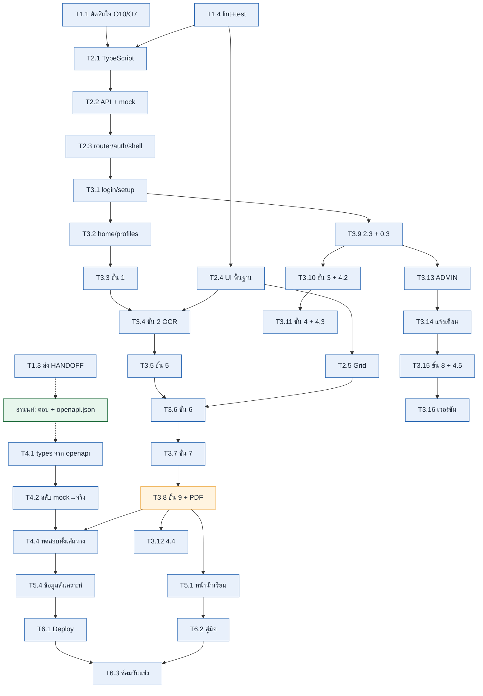

# ROADMAP: ระบบจัดตารางสอนอัตโนมัติ (ฝั่งหน้าเว็บ)

อัปเดต 2026-10-27 · ผู้ถือแผน: Pan (Frontend) · ฝั่งอานนท์ (Backend/OCR/FET) ปรากฏเป็นสิ่งที่ต้องพึ่งพา ไม่ได้วางแผนแทน
แผนนี้ **วิเคราะห์และวางลำดับเท่านั้น** ยังไม่มีการแก้ซอร์สโค้ด ติดตั้งแพ็กเกจ หรือรวม branch

**ป้ายที่ใช้:** ✔ ตรวจพบจากไฟล์จริง · 💡 ข้อเสนอของแผนนี้ · ❓ Uncertain (ไม่มีหลักฐาน ต้องยืนยัน)
**เรื่องเวลา:** ไม่มีหลักฐานพอจะประเมินระยะเวลาเป็นวัน (ไม่ทราบชั่วโมงทำงานต่อวัน และ Pan บอกเพียงว่า "ประมาณ 1–2 สัปดาห์") จึงแสดงเป็น **ลำดับและเส้นตัด** ไม่มีวันที่

---

## 1. Project Overview

| หัวข้อ | รายละเอียด |
|---|---|
| เป้าหมาย | เว็บจัดตารางสอนอัตโนมัติที่เริ่มจากไฟล์หลักสูตร (PDF) ผ่านการตรวจ → จัดตาราง → พิมพ์/ส่งออก โดยตรวจย้อนกลับได้ว่าทุกคาบมาจากหลักสูตรไหน ✔ ([requirements.md](requirements.md) และคำอธิบายโปรเจกต์) |
| ผู้ใช้ | HEAD, ASSISTANT, TEACHER, ADMIN ระดับสถาบัน + หน้านักเรียนสาธารณะแบบอ่านอย่างเดียว ✔ ([D12](decisions.md), [ADR 0001](../adr/0001-public-read-only-timetable.md)) |
| สถานศึกษาชุดแรก | อาชีวศึกษา (ปวช./ปวส.) ส่วนประเภทอื่นแสดงเป็นแผนงานในหน้าล็อกอิน ✔ ([ADR 0002](../adr/0002-vocational-first.md)) |
| ทีม | Pan = Frontend (+ Backend ส่วนบัญชี/CRUD ถ้าอานนท์ไม่รับ) · อานนท์ = FastAPI, OCR, FET, `/openapi.json` ✔ |
| บริบท | เกี่ยวกับการแข่งขันทักษะ AI จัดตารางสอน ปวส. ต้องมีโค้ด+คู่มือ ทดสอบด้วยข้อมูลสังเคราะห์ขนาดใหญ่ และเข้าถึงผ่านคลาวด์ ✔ (จากข้อความของ Pan) · ❓ กำหนดส่งจริง |
| สถาปัตยกรรม | React 19 + Vite 8 (Frontend) ↔ FastAPI project service (ผู้เขียนข้อมูลคนเดียว) ↔ FET + PostgreSQL ใน Docker, VM เดียวด้วย compose ✔ ([tech-stack](../th/8-tech-stack.md)) |

---

## 2. Current Status

### 2.1 โค้ดฝั่งหน้าเว็บ (ตรวจแล้วที่ `frontend/`)

| ด้าน | สถานะที่พบ |
|---|---|
| โครง | ✔ `src/` อยู่ที่ `frontend/src/` แล้ว มี `main.jsx` ✔ และมี `dist/` ✔ (ตีความว่า build เคยผ่านหนึ่งครั้ง ไม่ได้รันซ้ำ) — **เอกสารบอกว่ายังค้างอยู่ ซึ่งล้าสมัยแล้ว** ([README dev](README.md), [decisions "ค้างอยู่"](decisions.md)) |
| ขนาด | ✔ ซอร์สประมาณ 470 บรรทัดใน 12 ไฟล์ (`App`, `main`, 2 หน้า, `AppShell`, `TimetableGrid`, `Button`, `Badge`, `generate.js`, `sample.js`, 2 CSS) โฟลเดอร์ `hooks/ context/ redux/ services/ utils/ data/ pages/` มีแค่ `.gitkeep` |
| ภาษา/เครื่องมือ | ✔ JavaScript (JSX) · React 19.3.1, Vite 8.3.5, ESLint 10 · **`eslint.config.js` ว่าง (`export default []`)** · ไม่มี router, state/data lib, test runner, i18n, PDF viewer, DnD, ตัวสร้าง PDF/Excel |
| หน้าที่มี | ✔ 2 หน้าต้นแบบบนข้อมูลจำลอง: "สร้างตาราง" (Generate จำลอง, ถาด "ยังไม่ลง", มุมมองตามอาจารย์/ห้อง) และ "ตรวจทานตารางที่สกัดได้" (ยืนยันช่อง, ช่องถัดไปที่ต้องตรวจ) สลับหน้าด้วย `useState` ไม่มี URL |
| คอมโพเนนต์ | ✔ `AppShell` (ชื่อภาควิชา/ผู้ใช้เขียนตายตัว), `TimetableGrid` (แถว = วัน คอลัมน์ = คาบ ตามที่ตกลง, 6 สถานะ, aria), `Button`, `Badge` · design system §8 ระบุ 7 สถานะ ❓ ขาดสถานะใด (น่าจะ "ปักหมุด") |
| Mock API | ✔ `src/api/generate.js` คืนรูป flat `{status, placed[], unplaced[], score}` ใช้ id ตัวเลขและชื่ออาจารย์/ห้องตรง ๆ · **[api.md §7.1](api.md) บอกว่า "รูปเดียวกับ mock" แต่จริงไม่ตรง** (api.md มี `candidates[]`, `class_id`/`teacher_ids`/`room_id` เป็น id, `start_period`) ต้องมีตัวแปลง |
| สีหลัก | ✔ `tokens.css` ใช้ `--primary: #3d556f` · เอกสาร/O10 ระบุ `#1f5fae` → **โค้ดกับเอกสารไม่ตรงกัน** · สีสถานะ "ต้องแก้" ในโค้ด (`.tt-review`) เป็นส้มอยู่แล้ว ✔ |
| การทดสอบ | ✔ ไม่มี test ใด ๆ |
| Git | ✔ ไม่พบ `.git` ใน `frontend/` และ `doc/` ❓ มี repo ระดับบนหรือไม่ |

### 2.2 เอกสาร (`doc/`)

| ด้าน | สถานะ |
|---|---|
| ออกแบบครบ | ✔ requirements, pages-and-routes (31 หน้า), flows, data-model, api.md (ข้อเสนอ ~100 endpoint), decisions (D1–D12), design system, ER, wireframe (ขาด 3 หน้า ร่างไว้ใน [wireframes-missing.md](wireframes-missing.md)) |
| ผลของ grill-with-docs วันนี้ | ✔ [GLOSSARY.md](../GLOSSARY.md), [ADR 0001–0002](../adr/), [HANDOFF-ANON.md](../HANDOFF-ANON.md), [build-order.md](build-order.md) |
| ฝั่งอานนท์ | ❓ ยังไม่มีหลักฐานว่ามี API/OCR/FET ที่ใช้งานได้ สิ่งเดียวที่มีคือ api.md ซึ่งเป็นข้อเสนอ**จากฝั่งเรา** ([decisions O5, O6](decisions.md) ยังเปิด) |

### 2.3 ข้อจำกัด / ปัญหา / Technical Debt ที่ต้องจัดการก่อน

| # | ประเด็น | ผล |
|---|---|---|
| D-1 | JSX อยู่แล้ว แต่ตกลงใช้ TypeScript เป็นค่าเริ่มต้น (O7) ยิ่งเพิ่มหน้ายิ่งแปลงแพง ✔ | ตัดสินก่อนเริ่มเพิ่มหน้า |
| D-2 | `eslint.config.js` ว่าง ✔ ไม่มี test | ไม่มีตาข่ายนิรภัยก่อนขยายโค้ด |
| D-3 | เอกสารล้าสมัย/ขัดกัน ✔: README+decisions ("src ใต้ public"), requirements N3 และ §6 ("ไม่มีลิงก์สาธารณะ") ขัดกับ ADR 0001, "platform admin" ใน user-journeys, ตัวอย่าง "1/2027", `ASSIST` ใน flows, tech-stack ว่า "ยังไม่ตัดสิน TS" | อ่านเอกสารแล้วเข้าใจผิดได้ |
| D-4 | เอกสารเขียนสำหรับมหาวิทยาลัย แต่ผู้ใช้ชุดแรกคืออาชีวะ ✔ ER ไม่มีหมวดวิชา/ประเภทวิชา/กลุ่มอาชีพ/ชั่วโมงกิจกรรม/วิชาบังคับก่อน | ผังความต่อเนื่องและตรวจหลักสูตรทำไม่ได้จนกว่าอานนท์เพิ่ม |
| D-5 | mock ไม่ตรง api.md ✔ | ต้องมีชั้นแปลงก่อนต่อ API จริง |
| D-6 | สีหลักไม่ตรงระหว่างโค้ดกับเอกสาร ✔ | ตัดสินครั้งเดียวที่ `--primary` |

### 2.4 เอกสารที่ยึดเป็นหลัก

ลำดับความสำคัญเมื่อขัดกัน 💡: [ADR](../adr/) และ [D12](decisions.md) (ใหม่สุด) → [GLOSSARY.md](../GLOSSARY.md) → [requirements.md](requirements.md) §4 ข้อห้าม N1, N2 และ §7 R1–R8 → [pages-and-routes.md](pages-and-routes.md) → [api.md](api.md) (ข้อเสนอ ปรับตาม `/openapi.json` เมื่อมี) → [design-system.md](../th/7-design-system/design-system.md)

---

## 3. Goals & Scope

**เป้าหมายหลัก:** หัวหน้าภาควิชาอัปโหลด PDF หลักสูตร ตรวจผลอ่าน สร้างตารางที่ไม่ชน และพิมพ์/ส่งออกได้ ภายใน ≤ 30 นาทีต่อภาคเรียน ([requirements §5](requirements.md)) โดยอาจารย์ให้เวลาว่างและตรวจทานได้ นักเรียนดูตารางที่เผยแพร่แล้วได้

### 3.1 จัดระดับ (MoSCoW)

| ระดับ | งาน |
|---|---|
| **Must** | เส้นทางหลักชั้น A (0.1, 0.0, 2.1, 2.2, ขั้น 1, 2, 5, 6, 7, 9) · ส่งออก PDF · ข้อมูลอาจารย์/ห้อง/เวลาว่างเข้าระบบได้ (2.3, ขั้น 3–4, 4.1–4.4) · หน้านักเรียนสาธารณะ · ทดสอบด้วยข้อมูลสังเคราะห์ขนาดใหญ่ · คู่มือ · ติดตั้งบน VM |
| **Should** | หน้า ADMIN 3.1–3.4 · ตรวจทาน/คำขอ (ขั้น 8, 4.5) · เวอร์ชัน (2.4.2) · แจ้งเตือน (1.1) · ส่งออก Excel + มุมมองรายวิชา · test อัตโนมัติของเส้นทางหลัก |
| **Could** | 3.5 + 2.4.1 (รูปแบบไฟล์ที่ไม่รู้จัก) · 3.6 ระบบ · 1.2 บัญชีของฉัน · 0.2 รีเซ็ตรหัสผ่าน · ภาษาอังกฤษ · มุมมองมือถือแบบอ่าน |
| **Won't (นอกขอบเขต)** | บทบาท/บัญชีนักศึกษา · ตารางสอบ · นักศึกษาเลือกวิชาเลือกในระบบ · SSO · สถานศึกษาประเภทอื่นนอกอาชีวะ · ลากวางเต็มรูปแบบ, command palette, Storybook, realtime presence, ธีมสถาบัน (design system §8 "ภายหลัง") · ตัว OCR และ solver (ของอานนท์) |

เหตุผลที่หน้า C บางหน้าเป็น Could: ภาควิชาเดียวใน MVP ✔ (D12, O9) และรูปแบบ PDF อาชีวะที่รู้จักเป็นทางหลักอยู่แล้ว

### 3.2 เกณฑ์ว่า "เสร็จ" ระดับฟีเจอร์
ดู [หัวข้อ 9](#9-acceptance-criteria) และ [หัวข้อ 12](#12-definition-of-done)

---

## 4. Development Phases

| Phase | ชื่อ | ครอบคลุม | ชั้น (grill) |
|---|---|---|---|
| 1 | ตรวจสอบและเตรียมความพร้อม | ตัดสินใจที่ค้าง, ซิงก์เอกสาร, ส่งรายการให้อานนท์, ตั้ง lint/test | — |
| 2 | รากฐานและสัญญา | TypeScript, ชั้น API + mock ที่ตรง api.md, router/auth/role, คอมโพเนนต์พื้นฐาน | — |
| 3A | เส้นทางหลัก | ล็อกอิน → PDF → ตรวจ → สร้าง → ดาวน์โหลด PDF | A |
| 3B | ข้อมูลคนและรอบเวลาว่าง | 2.3, ขั้น 3–4, หน้าอาจารย์ | B |
| 3C | ผู้ดูแล + ตรวจทาน | ADMIN, ขั้น 8, เวอร์ชัน, แจ้งเตือน, ที่เหลือ | C |
| 4 | เชื่อม API จริง | สลับ mock → จริงทีละกลุ่มเส้น เมื่อ `/openapi.json` พร้อม | (ทำคู่ขนานกับ 3) |
| 5 | ส่วนเสริม ทดสอบ ขัดเกลา | หน้านักเรียน, Excel, a11y, ข้อมูลสังเคราะห์, E2E | D |
| 6 | ส่งมอบ / Deploy | compose บน VM, คู่มือ, ชุดซอร์ส | D |

**เส้นตัด 💡:** ถ้าเวลาไม่พอ ให้หยุดหลัง **Phase 3A + 4 ของชั้น A** เพราะครบเส้นทางตั้งแต่ PDF จนได้ตารางพิมพ์ แล้วทำเฉพาะ "หน้านักเรียน", "ข้อมูลสังเคราะห์", "คู่มือ", "Deploy" จากชั้น D โดยข้ามส่วนที่เหลือของ B/C (ใช้ข้อมูลจำลอง/seed แทนตามที่ชั้น A ทำอยู่แล้ว)

---

## 5. Task Breakdown

คอลัมน์: **เป้าหมาย / ดำเนินการ** · **ไฟล์ที่เกี่ยว** · **ต้องมาก่อน** · **ผลลัพธ์ + เกณฑ์ผ่าน (AC)** · **ความเสี่ยง** · **P** (ดู [หัวข้อ 7](#7-priorities))
รายการหน้าแบบละเอียดและช่องติ๊กอยู่ใน [build-order.md](build-order.md) ไม่ซ้ำที่นี่

### Phase 1: ตรวจสอบและเตรียมความพร้อม

| ID | เป้าหมาย / ดำเนินการ | ไฟล์ | ต้องมาก่อน | ผลลัพธ์ + AC | ความเสี่ยง | P |
|---|---|---|---|---|---|---|
| T1.1 | ปิดการตัดสินใจที่ค้าง: O10 สีหลัก (`#3d556f` ในโค้ด vs `#1f5fae` ในเอกสาร), O7 แปลงเป็น TS หรือไม่, อนุมัติแก้เอกสารเดิม | `decisions.md`, `tokens.css` | — | บันทึกคำตอบใน decisions.md · ไม่เหลือข้อ ❓ ในส่วนนี้ | ถ้าไม่ตัดสิน งานเฟส 2 หยุดที่ T2.1 | P0 |
| T1.2 | ซิงก์เอกสารล้าสมัยตามรายการ D-3 หลังได้รับอนุมัติ | `dev/README.md`, `dev/decisions.md`, `dev/requirements.md`, `2-user-journeys/*`, `4-user-flows/make-flows.py`, `th/6-er-diagram/*`, `th/8-tech-stack.md` | T1.1 | `grep` ไม่พบข้อความเก่าที่ระบุ · ไดอะแกรม F2–F9 สร้างใหม่ | แก้ไฟล์ของอานนท์โดยไม่แจ้ง — ต้องแจ้งก่อน | P1 |
| T1.3 | ส่ง HANDOFF-ANON.md ให้อานนท์ และขอคำตอบข้อ 1.1–1.7 | `HANDOFF-ANON.md` | — | ได้คำตอบเรื่อง: รับ §2–4 หรือไม่, auth, FET, `/check`, `class_id`, bbox/confidence | อานนท์ไม่ตอบ → ใช้ค่าที่ api.md เสนอและรับความเสี่ยงเรื่อง contract | P0 |
| T1.4 | ตั้งฐานเครื่องมือ: ใส่กฎ ESLint, เพิ่ม Vitest + Testing Library + axe (ตามที่ tech-stack เสนอ), สคริปต์ `test` | `eslint.config.js`, `package.json` | T1.1 | `npm run lint`, `npm test`, `npm run build` ผ่านบนโค้ดปัจจุบัน | เพิ่มแพ็กเกจ → ต้องได้อนุมัติตามหลัก "ไม่เพิ่มเทคโนโลยีโดยไม่มีเหตุผล" (เหตุผล: มีข้อกำหนด a11y และ DoD ของ design system) | P0 |

### Phase 2: รากฐานและสัญญา

| ID | เป้าหมาย / ดำเนินการ | ไฟล์ | ต้องมาก่อน | ผลลัพธ์ + AC | ความเสี่ยง | P |
|---|---|---|---|---|---|---|
| T2.1 | แปลงเป็น TypeScript (ถ้า T1.1 อนุมัติ): tsconfig, เปลี่ยน 12 ไฟล์, เขียน type โดเมนมือไว้ก่อนจนมี OpenAPI | `src/**`, `vite.config.js` | T1.1, T1.4 | `tsc --noEmit` ผ่าน · พฤติกรรมเดิมไม่เปลี่ยน (2 หน้าต้นแบบทำงานเหมือนเดิม) | ยิ่งช้ายิ่งแพง; ถ้าเลือกอยู่ JS ให้ข้ามและใช้ JSDoc | P0 |
| T2.2 | ชั้น API + mock ที่ตรงรูป api.md: client เดียว, mock ต่อกลุ่มเส้นที่ชั้น A ใช้ (auth, profiles, uploads, year-plans, runs, check, versions), ตัวแปลงผลรัน (`candidates[]` → รูปที่ UI ใช้) | `src/api/**`, `src/data/**`, [api.md](api.md) §2–8 | T2.1 | UI ไม่ import `data/sample.js` โดยตรงอีก · สลับ mock→จริงเปลี่ยนที่ `src/api/` ที่เดียว | ถ้าเปลี่ยนตาม api.md ก่อนอานนท์ตอบ อาจต้องแก้ซ้ำ → ทำตัวแปลงแยกไฟล์ | P0 |
| T2.3 | Router + เซสชัน + ป้องกันเส้นทางตามบทบาท + AppShell จริง (ตัวสลับภาควิชา เมื่อ memberships > 1, กระดิ่ง, Stepper 9 ขั้น) + พจนานุกรมข้อความตามประเภทสถานศึกษา + ตัวแปลง พ.ศ. | `src/App.*`, `src/components/layout/**`, `src/context/**`, `src/utils/**` | T2.2 | เข้า `/admin` ด้วยบัญชี TEACHER ถูกปฏิเสธ · ป้ายภาคเรียนแสดง "1/2570" · อาชีวะแสดง "แผนกวิชา/ครู" | จะเลือก React Router + Context ตาม tech-stack (ข้อเสนอ ยังไม่ติดตั้ง) | P0 |
| T2.4 | คอมโพเนนต์พื้นฐานที่ขาด: Input/Select, Dialog/Confirm, Toast, InlineAlert, EmptyState, Skeleton, DataTable, Tabs + test + a11y | `src/components/ui/**` | T1.4 | ทุกตัวมี test และผ่าน axe · ใช้ `var(--…)` เท่านั้น | ทำเกินจำเป็น → ทำเฉพาะที่หน้าชั้น A ใช้ก่อน | P0 |
| T2.5 | อัปเกรด TimetableGrid: สถานะปักหมุด, คีย์บอร์ด, แสดงช่วงคาบจากข้อมูล (ไม่ฝังคาบ 1–10) | `src/components/timetable/TimetableGrid.*` | T2.4 | เลือกช่องด้วยคีย์บอร์ดได้ · ทำงานกับจำนวนคาบ/วันที่ต่างกัน | ❓ โครงคาบจริงของ ปวส. (ตอนนี้ตัวอย่างคือ 10 คาบ 08:00–17:00) | P1 |

### Phase 3A: เส้นทางหลัก (ชั้น A)

| ID | เป้าหมาย / ดำเนินการ | ไฟล์ | ต้องมาก่อน | ผลลัพธ์ + AC | ความเสี่ยง | P |
|---|---|---|---|---|---|---|
| T3.1 | 0.1 ล็อกอิน + 0.0 ตั้งค่าครั้งแรก (ตั้ง `institution.type`) + stub 3.1 | `src/pages/auth/**` | T2.3 | ล็อกอินแล้วไปหน้าแรกตามบทบาท · ผิดรหัสแสดงข้อความ · 0.0 แสดงครั้งเดียว | cookie vs token (ถามอานนท์ ข้อ 1.2) | P1 |
| T3.2 | 2.1 หน้าแรก + 2.2 โปรไฟล์ + โครง 2.4 (กฎ Stepper: ขั้นปลดล็อกเมื่อขั้นก่อนเสร็จ) | `src/pages/head/**` | T3.1 | สร้าง/คัดลอกโปรไฟล์ได้บน mock · ย้อนขั้นแล้วขั้นหลังถูกทำเครื่องหมายล้าสมัย | กฎ `STEP_LOCKED/STEP_OUT_OF_DATE` ตีความผิด | P1 |
| T3.3 | ขั้น 1: อัปโหลด PDF (`multipart`, 202 + poll), การ์ด "สิ่งที่เราพบ" | `…/setup` | T3.2 | แสดงสถานะ `queued→reading→ready/needs_format/failed` · `FILE_UNREADABLE` แสดงเหตุผล | ❓ OCR ใช้เวลาเท่าไร / มีหรือยัง | P1 |
| T3.4 | ขั้น 2: หน้าตรวจ OCR หน้าเดียว — ซ้ายภาพหน้า PDF ขวาตาราง "แถวแดงถัดไป" ตัวกรอง + ผังความต่อเนื่อง | `…/review`, SplitPane, PDF viewer | T3.3, T2.4 | คลิกค่า → ภาพหน้า+ไฮไลต์ · ไปต่อไม่ได้ถ้าเหลือแถวแดง (`RED_ROWS_REMAIN`) | **เสี่ยงสูง:** ต้องมีภาพหน้า PDF/`bbox` จากอานนท์ (ข้อ 1.6) และข้อมูลวิชาบังคับก่อนสำหรับผัง (HANDOFF 2.5) | P1 |
| T3.5 | ขั้น 5: กฎ + วิชาเลือก + pre-check + Acknowledge | `…/rules` | T3.4 | Generate ถูกล็อกจน acknowledge (R4) · บันทึกการรับทราบ | น้ำหนักกฎ/ชนิดกฎต้องรอสเปกอานนท์ | P1 |
| T3.6 | ขั้น 6: Generate + จัดตาราง แบ่ง 3 รอบ: (1) แสดงผล + ถาด + Skeleton + แคชผลรัน (2) เลือกช่อง + แผงแก้ + ปักหมุด (3) ลากย้าย + `POST /api/check` | `…/generate` | T3.5, T2.5 | ผลบางส่วนไม่ถือว่าล้มเหลว (R5) · รีเฟรชแล้วผลไม่หาย · แต่ละคาบที่ยังไม่ลงมีเหตุผล+วิธีแก้ | **หน้ายากสุด**; ความเร็ว `/check` ไม่ทราบ (ข้อ 1.4); `class_id` คงที่ไหม (ข้อ 1.5) | P1 |
| T3.7 | ขั้น 7: ห้อง + อาจารย์ต่อคาบ + พรีวิว A4 | `…/assign` | T3.6 | ทุกคาบมีห้อง+อาจารย์จึงไปต่อได้ · พรีวิวตรงกับที่จะพิมพ์ | ห้องชนข้ามภาควิชา (`ROOM_BOOKED`) | P1 |
| T3.8 | ขั้น 9: เผยแพร่ (เฉพาะ HEAD) + ดาวน์โหลด PDF ต่อกลุ่ม/อาจารย์/ห้อง สร้างในเบราว์เซอร์ | `…/publish` | T3.7 | ASSISTANT กดเผยแพร่ → ถูกปฏิเสธ (`HEAD_ONLY`) · PDF เปิดแล้วอักษรไทยถูกต้อง | **ฟอนต์ไทยใน PDF ฝั่งเบราว์เซอร์** ❓ ยังไม่เลือกไลบรารี | P1 |

### Phase 3B: ข้อมูลคนและรอบเวลาว่าง (ชั้น B)

| ID | เป้าหมาย / ดำเนินการ | ไฟล์ | ต้องมาก่อน | ผลลัพธ์ + AC | ความเสี่ยง | P |
|---|---|---|---|---|---|---|
| T3.9 | 2.3 บุคลากรและห้อง + 0.3 รับคำเชิญ | `src/pages/head/People*`, `src/pages/auth/Invite*` | T3.1 | เชิญอาจารย์ → ลิงก์ → ตั้งรหัสผ่านเข้าได้ · ลิงก์หมดอายุไม่สร้างบัญชี (`INVITE_EXPIRED`) | ❓ สิทธิ์ผู้ช่วยเชิญ (D12 ตกลงแล้ว) ต้องตรงกับ api.md §4 | P1 |
| T3.10 | ขั้น 3 + 4.2 + 4.1: รอบเวลาว่าง ทำสองฝั่งพร้อมกัน | `…/availability`, `/t`, `/t/availability` | T3.9 | อาจารย์กรอกครั้งเดียวต่อคนต่อภาค (R8) · HEAD เห็นสถานะรายคนและช่อง "ไม่ว่างที่ภาควิชาอื่น" | กรอกซ้ำข้ามภาควิชา | P1 |
| T3.11 | ขั้น 4 + 4.3: รายการ BLOCKER/WARNING พร้อมเธรดความเห็น (เธรดเดียวกันสองฝั่ง) | `…/issues`, `/t/issues` | T3.10 | BLOCKER ต้องแก้ · WARNING ยอมรับ+หมายเหตุได้ (R3) · `ISSUES_UNDECIDED` กันไปต่อ | ความเห็นพร้อมกันสองฝั่ง | P1 |
| T3.12 | 4.4 ตารางของฉัน (อ่าน) | `/t/timetable` | T3.8 | เห็นเฉพาะคาบของตัวเอง · ติดป้าย DRAFT/เผยแพร่ถูกต้อง (N2) | รั่วข้อมูลของอาจารย์อื่น — ตรวจที่ backend ด้วย | P1 |

### Phase 3C: ผู้ดูแล + ตรวจทาน (ชั้น C)

| ID | เป้าหมาย / ดำเนินการ | ไฟล์ | ต้องมาก่อน | ผลลัพธ์ + AC | ความเสี่ยง | P |
|---|---|---|---|---|---|---|
| T3.13 | ADMIN หลัก: 3.4 ปฏิทิน → 3.2 ภาควิชา+หัวหน้า → 3.3 ห้องร่วม → 3.1 หน้าแรก | `src/pages/admin/**` | T3.9 | ขั้น 1 เลือกภาคเรียนจากปฏิทินจริงแทน seed (`TERM_NOT_IN_CALENDAR`) | ❓ ต้องให้ Pan ทำ backend ส่วนนี้เองถ้าอานนท์ไม่รับ | P2 |
| T3.14 | 1.1 แจ้งเตือน | `/notifications` | T3.13 | แสดงคำเชิญ กำหนดส่ง "แก้โดย…" เผยแพร่แล้ว · จำนวนที่กระดิ่งตรงกับรายการ | polling vs push ❓ | P2 |
| T3.15 | ขั้น 8 + 4.5: ส่งเข้า REVIEW, คำขอเปลี่ยน, อนุมัติ/ปฏิเสธพร้อมผลกระทบ ("ย้ายอีก 2 คาบ"), direct edit | `…/review-by-teachers`, `/t/requests` | T3.14 | R6, R7 ครบ · อาจารย์ที่ได้รับผลกระทบถูกแจ้งเก่า/ใหม่ | ตรรกะรันซ้ำโดยปักหมุดทั้งหมดอยู่ที่ backend | P2 |
| T3.16 | 2.4.2 เวอร์ชัน + บันทึกการเปลี่ยนแปลง ("เริ่มการเปลี่ยนแปลง" หลังเผยแพร่) | `…/versions` | T3.15 | เวอร์ชัน `published` แก้ไม่ได้ (`VERSION_LOCKED`) · สร้างเวอร์ชันใหม่ได้ | — | P2 |
| T3.17 | 3.5 รูปแบบหลักสูตร + 2.4.1 ตั้งค่ารูปแบบไฟล์ (ทำคู่) | `/admin/formats`, `…/setup/format` | T3.13, T3.3 | บันทึกรูปแบบใหม่เป็น unverified → ADMIN อนุมัติ → ใช้ได้ | ใช้เมื่อ OCR อ่านไม่ออกเท่านั้น | P3 |
| T3.18 | 1.2 บัญชีของฉัน + 0.2 รีเซ็ตรหัสผ่าน (ร่างหน้าใน wireframes-missing) | `/account`, `/reset` | T3.1 | เปลี่ยนรหัส/ภาษาได้ · ลิงก์รีเซ็ตหมดอายุ → 410 ข้อความถูกต้อง | — | P3 |
| T3.19 | 3.6 ระบบ (สถานะบริการ + SMTP ก่อน, สำรอง/กู้คืนทีหลัง) | `/admin/system` | T3.13 | แสดงสถานะบริการจริง | ต้องการ endpoint ที่อานนท์ยังไม่มี ❓ | P3 |

### Phase 4: เชื่อม API จริง (คู่ขนานกับ Phase 3)

| ID | เป้าหมาย / ดำเนินการ | ไฟล์ | ต้องมาก่อน | ผลลัพธ์ + AC | ความเสี่ยง | P |
|---|---|---|---|---|---|---|
| T4.1 | สร้าง type จาก `/openapi.json` (เช่น `openapi-typescript` ตามที่เอกสารเสนอ) แทน type เขียนมือ | `src/api/types.*` | T1.3 (อานนท์ส่ง Pydantic model) | `tsc` ผ่านกับ schema จริง · ส่วนที่ต่างจาก api.md ถูกบันทึกลง api.md | schema ไม่ตรง → แก้ที่ตัวแปลงอย่างเดียว | P0 |
| T4.2 | สลับ mock → จริงทีละกลุ่ม: auth → profiles/uploads → year-plans/flow → runs/check → versions/publish | `src/api/**` | T4.1 + backend ส่งกลุ่มนั้น | แต่ละกลุ่มผ่านเทสต์ contract (mock และจริงให้รูปเดียวกัน) | พึ่งอานนท์ — เป็นเส้นทางวิกฤตภายนอก | P1 |
| T4.3 | จัดการสถานะผิดพลาดตามรหัส error ใน api.md (ทุกรหัสมีข้อความไทยและการกระทำถัดไป) | `src/api/errors.*`, หน้าต่าง ๆ | T4.2 | ทดสอบแต่ละรหัสบน mock ได้ข้อความถูกต้อง | — | P1 |
| T4.4 | ทดสอบเส้นทางหลักบน backend จริงหนึ่งรอบ ตั้งแต่ PDF ถึงดาวน์โหลด | — | T3.8, T4.2 | จับเวลาตามตัวชี้วัด ≤ 30 นาที; ไม่มีชนแบบ hard | OCR/solver ช้ากว่าที่คาด | P1 |

### Phase 5: ส่วนเสริม ทดสอบ ขัดเกลา (ชั้น D)

| ID | เป้าหมาย / ดำเนินการ | ไฟล์ | ต้องมาก่อน | ผลลัพธ์ + AC | ความเสี่ยง | P |
|---|---|---|---|---|---|---|
| T5.1 | หน้านักเรียนสาธารณะ (อ่านอย่างเดียว, ไม่ล็อกอิน, เฉพาะเวอร์ชันที่ HEAD เผยแพร่, มุมมองกลุ่มเรียน) | `src/pages/public/**` | T3.8, endpoint จากอานนท์ ([HANDOFF 3.1](../HANDOFF-ANON.md)) | ไม่มีข้อมูลร่าง/อีเมล/เวลาไม่ว่าง · ใช้งานได้บนมือถือ | N2 — ต้องมี rate limit ฝั่ง backend | P1 |
| T5.2 | ส่งออก Excel + มุมมองรายวิชา (`view=subject`) | `src/utils/export*` | T3.8 | ไฟล์ Excel เปิดได้และตรงกับตารางบนจอ | ไลบรารีเพิ่ม → ต้องมีเหตุผลก่อนติดตั้ง | P2 |
| T5.3 | ผ่านรายการ a11y (design system §6.3) · i18n ไทย/อังกฤษ · มุมมองมือถือแบบอ่านของ 4.2 และ 4.4 | ทั้งแอป | T3.12 | axe ไม่พบข้อผิดระดับร้ายแรง · ไม่มีข้อความ hardcode นอกพจนานุกรม | — | P2 |
| T5.4 | ทดสอบด้วยข้อมูลสังเคราะห์ขนาดใหญ่ (ตามโจทย์การแข่งขัน) — ตารางหลายกลุ่ม/อาจารย์/ห้อง | สคริปต์ seed + `TimetableGrid` | T4.4 | หน้าตารางและรายการไม่กระตุกที่ขนาดเป้าหมาย ❓ (ยังไม่กำหนด) | ❓ "ขนาดใหญ่" คือเท่าไร | P1 |
| T5.5 | E2E เส้นทางหลัก (Playwright — ข้อเสนอ) + บันทึกวิธีทดสอบมือสำหรับส่วนที่เหลือ | `e2e/**` | T4.4 | รันซ้ำได้ ผ่านทั้งเส้นทางหลัก | เพิ่มเครื่องมือ → ตัดสินตอนถึงเฟสนี้ | P2 |

### Phase 6: ส่งมอบ / Deploy

| ID | เป้าหมาย / ดำเนินการ | ไฟล์ | ต้องมาก่อน | ผลลัพธ์ + AC | ความเสี่ยง | P |
|---|---|---|---|---|---|---|
| T6.1 | ปรับให้ติดตั้งบน VM เดียวด้วย `docker compose` ชุดเดียวกัน หน้าเว็บ+API โดเมนเดียวกันผ่าน reverse proxy (build หน้าเว็บเป็นไฟล์สถิตหลัง nginx ตาม tech-stack) | `frontend/Dockerfile`*, compose | T4.4, ❓ ใครเขียน compose | เครื่องใหม่ `docker compose up` → 0.0 → ใช้งานได้ | CORS/คุกกี้ข้ามโดเมน; ❓ ผู้ให้ VM | P1 |
| T6.2 | คู่มือผู้ใช้ (ตามบทบาท) + คู่มือติดตั้ง | `doc/` | T5.1 | ทำตามคู่มือจนได้ตารางพิมพ์โดยไม่ต้องถาม | — | P1 |
| T6.3 | ชุดซอร์สส่งมอบ + ซ้อมวันแข่งหนึ่งรอบ (นำข้อมูลที่ไม่เคยเห็นเข้าระบบ) | — | T6.1, T6.2 | ซ้อมแล้วบันทึกเวลาและจุดสะดุด | ❓ รูปแบบโจทย์วันแข่ง | P1 |

\* ชื่อไฟล์เป็นข้อเสนอ ยังไม่มีในโปรเจกต์

---

## 6. Dependencies & Critical Path

### 6.1 แผนภาพลำดับ

ส้ม = เส้นตัดชั้น A · เขียว = ฝั่งอานนท์

### 6.2 เส้นทางวิกฤต 💡
`T1.1 → T2.1 → T2.2 → T2.3 → T3.1 → T3.2 → T3.3 → T3.4 → T3.5 → T3.6 → T3.7 → T3.8 → T4.4 → T5.4 → T6.1 → T6.3`
งานภายนอกที่ขนานแต่ **บล็อกเส้นนี้ได้**: คำตอบอานนท์ (T1.3), OCR คืนภาพหน้า/`bbox` (T3.4), `/openapi.json` (T4.1)

### 6.3 ทำคู่ขนานได้ / ต้องทำเป็นคู่
- ขนานได้: T1.2 กับ T1.3 · T2.4 กับ T2.2–2.3 · ทั้งชั้น B กับ C เมื่อชั้น A เสร็จ (ถ้ามีคนเดียวให้ทำตามลำดับ)
- ต้องทำเป็นคู่ (ข้อมูลร่วมกันสองฝั่ง): ขั้น 3 ↔ 4.2 · ขั้น 4 ↔ 4.3 · ขั้น 8 ↔ 4.5 · 2.4.1 ↔ 3.5

### 6.4 งานที่กระทบโค้ดเดิม
- T2.1 (เปลี่ยนนามสกุลและ type ทุกไฟล์) และ T2.2 (ตัด `data/sample.js` ออกจากหน้า) แตะ 2 หน้าต้นแบบทั้งหมด → ทำก่อนเพิ่มหน้าใหม่
- T2.5 แตะ `TimetableGrid` ที่ทั้ง 2 หน้าใช้ → ต้องมี test คุมก่อนแก้ (T1.4)
- T1.2 แตะไฟล์เอกสารของอานนท์ → แจ้งก่อน

---

## 7. Priorities

| P | ความหมาย | งาน | เหตุผล |
|---|---|---|---|
| **P0** | ต้องทำก่อนระบบจะพัฒนาต่อได้ถูกต้อง | T1.1, T1.3, T1.4, T2.1–T2.4, T4.1 | ทุกหน้าถัดไปสร้างบนสิ่งเหล่านี้; ตัดสินช้า = แก้ซ้ำทุกหน้า |
| **P1** | จำเป็นต่อเป้าหมายหลัก | ชั้น A ทั้งหมด (T3.1–T3.8), T3.9–T3.12, T4.2–T4.4, T5.1, T5.4, T6.1–T6.3, T2.5, T1.2 | เส้นทาง PDF→ตารางพิมพ์ + ข้อกำหนดการแข่งขัน (หน้านักเรียน, ข้อมูลสังเคราะห์, คู่มือ, ออนไลน์) |
| **P2** | ปรับปรุง/ขยายความสามารถ | T3.13–T3.16, T5.2, T5.3, T5.5 | ภาควิชาเดียวใน MVP ใช้ seed แทนได้; ผู้ใช้ได้ประโยชน์แต่ไม่ขวางเส้นทางหลัก |
| **P3** | เสริม / ยังไม่จำเป็น | T3.17, T3.18, T3.19 | ทางสำรอง (รูปแบบไฟล์ไม่รู้จัก), ความสะดวก, การดูแลระบบ |

---

## 8. Milestones & Deliverables

ไม่มีวันที่ — เรียงตามลำดับ ผ่านก็ต่อเมื่อตรงเกณฑ์ใน [หัวข้อ 9](#9-acceptance-criteria)

| M | ชื่อ | สิ่งที่ส่งมอบ | อยู่ใน |
|---|---|---|---|
| M0 | พร้อมเริ่ม | ตัดสินใจ O10/O7 · ส่ง HANDOFF · lint/test/build เขียว | Phase 1 |
| M1 | โครงที่ใช้ต่อได้ | TS (หรือยืนยัน JS) · ชั้น API+mock · router/บทบาท/shell · UI พื้นฐาน | Phase 2 |
| M2 | **เดโมเส้นทางหลักบน mock (เส้นตัด)** | ล็อกอิน → อัปโหลด → ตรวจ OCR → กฎ → สร้าง → ห้อง/อาจารย์ → เผยแพร่ → PDF | Phase 3A |
| M3 | วงจรอาจารย์ | เชิญ → เวลาว่าง → รายการปัญหา → ตารางของฉัน | Phase 3B |
| M4 | ครบ 31 หน้า | ADMIN, แจ้งเตือน, ตรวจทาน/คำขอ, เวอร์ชัน, ที่เหลือ | Phase 3C |
| M5 | ต่อ API จริง | เส้นทางหลักทำงานกับ backend จริง จับเวลา ≤ 30 นาที | Phase 4 |
| M6 | ครบส่วนเสริมและผ่านทดสอบ | หน้านักเรียน, Excel, a11y, ข้อมูลสังเคราะห์, E2E | Phase 5 |
| M7 | ส่งมอบ | VM ใช้งานได้ · คู่มือ · ชุดซอร์ส · ซ้อมวันแข่งแล้ว | Phase 6 |

---

## 9. Acceptance Criteria

| M | เกณฑ์ผ่าน (ตรวจได้) |
|---|---|
| M0 | `npm run lint`, `npm test`, `npm run build` ผ่านบนโค้ดปัจจุบัน · decisions.md ไม่มี O7/O10 ค้าง · มีคำตอบอานนท์ข้อ 1.1–1.7 หรือบันทึกว่าไม่ตอบ |
| M1 | หน้าต้นแบบเดิม 2 หน้าทำงานเหมือนเดิมหลังแปลง · ไม่มี `import … data/sample` ในหน้า · เข้าหน้าที่ผิดบทบาทถูกปฏิเสธ · ทุกตัวใน `ui/` มี test+axe |
| M2 | ทำตามเส้นทางหลักบน mock ได้จนได้ PDF โดยไม่ต้องแก้โค้ด · R1, R2, R4, R5 พิสูจน์ได้ด้วยมือ (ตรวจจับก่อนยืนยัน, แถวแดงถัดไป, acknowledge, ผลบางส่วน) · รีเฟรชในขั้น 6 แล้วผลรันอยู่ |
| M3 | R3, R8 ผ่าน (BLOCKER/WARNING, เวลาว่างครั้งเดียวต่อคน) · อาจารย์เห็นเฉพาะคาบตัวเอง |
| M4 | ครบ 31 เส้นทางเข้าถึงได้ตามบทบาท · R6, R7 ผ่าน · เวอร์ชันที่เผยแพร่แก้ไม่ได้ |
| M5 | เส้นทางหลักผ่านบน backend จริง · ไม่มีชนแบบ hard · ทุกคาบอยู่ในตารางหรือถาดพร้อมเหตุผล · เวลาต่อภาค ≤ 30 นาที (เป้าแรก) |
| M6 | หน้านักเรียนไม่เปิดเผยข้อมูลนอกรายการที่ตกลง (ตรวจด้วย response จริง) · axe ไม่พบร้ายแรง · ข้อมูลสังเคราะห์ตามขนาดเป้าหมายไม่ทำให้หน้าค้าง |
| M7 | เครื่องใหม่ `docker compose up` แล้วทำตามคู่มือได้ถึงตารางพิมพ์ · ซ้อมวันแข่งด้วยข้อมูลที่ไม่เคยเห็น 1 รอบ |

---

## 9.1 Progress (อัปเดต 2026-10-27)

ตรวจล่าสุด: `npm run typecheck`, `npm run lint`, `npm test` (173 ผ่าน), `npm run build` ผ่านทั้งหมด · ยังไม่ได้เปิดดูในเบราว์เซอร์จริง

| งาน | สถานะ | หมายเหตุ |
|---|---|---|
| T1.1 ตัดสินใจ O7/O10 | ✔ | [D13](decisions.md): TypeScript, สีหลัก `#3d556f` |
| T1.2 ซิงก์เอกสารล้าสมัย | ◐ | แก้ README/decisions แล้ว ยังเหลือ requirements N3, user-journeys, make-flows.py, tech-stack |
| T1.3 ส่ง HANDOFF ให้อานนท์ | ☐ | ต้องให้คนส่งเอง ยังไม่มีคำตอบ |
| T1.4 lint + test | ✔ | ESLint (typescript-eslint + react-hooks), Vitest + Testing Library + vitest-axe |
| T2.1 TypeScript | ✔ | ทุกไฟล์ใน `src/` เป็น `.ts/.tsx` strict |
| T2.2 ชั้น API + mock | ◐ | `runs`, `auth`, `institution`, `profiles` มี mock รูปตาม api.md + test · `ReviewExtract` ยังใช้ `data/sample` ตรง (รอ API ขั้น 2) |
| T2.3 router/เซสชัน/บทบาท/shell | ✔ | hash router (มี id), `SessionProvider`, ตัวสลับ (รวม "ผู้ดูแลสถาบัน"), ป้องกันเส้นทาง · พจนานุกรมข้อความตามประเภทสถานศึกษามี (`utils/terminology.ts`) แต่ยังไม่ได้ใช้ครบทุกข้อความ |
| T2.4 UI พื้นฐาน | ✔ | Button, Badge, InlineAlert, EmptyState, Skeleton, Field (Text/Select), Dialog, ConfirmDialog, Toast, Tabs, DataTable (เรียง, แถวมีปัญหา) · ทุกตัวมี test + axe |
| T2.5 Grid | ✔ | `role=grid > row > gridcell` ผ่าน axe, ลูกศรย้ายช่อง, จุด Tab เดียว, สถานะปักหมุด · ❓ โครงคาบจริงของ ปวส. ยังไม่ทราบ (ตัวอย่างคือ 10 คาบ) |
| T3.1 ล็อกอิน + 0.0 | ✔ (mock) | ล็อกอิน, รายการประเภทสถานศึกษา (อาชีวะใช้งานได้ ที่เหลือ "เร็ว ๆ นี้"), 0.0 ตั้งค่าครั้งแรกใช้ได้ครั้งเดียว · ❓ ยังไม่ชัดว่าการ์ดอาชีวะ "กดได้" ทำอะไร (ADR 0002) ตอนนี้เป็นป้ายสถานะ |
| T3.2 หน้าแรก 2.1 + โปรไฟล์ 2.2 + โครง 2.4 | ✔ (mock) | สร้าง/คัดลอกโปรไฟล์, Stepper 9 ขั้น, แท็บ หลักสูตร × ชั้นปี, กฎล็อก/ล้าสมัยต่อ year plan (`profile/steps.ts`), ConfirmDialog บอกผลกระทบ · เนื้อหาของแต่ละขั้นยังเป็น placeholder พร้อมปุ่มจำลอง |
| T3.3–T3.4 (ขั้น 1, 2) | ☐ | ต้องรอ OCR/ไฟล์ PDF ตัวอย่างจากอานนท์ (T1.3) |
| T3.5 ขั้น 5 กฎ + pre-check + Acknowledge | ✔ (mock) | กฎ hard อ่านอย่างเดียว + soft เปิดปิด/น้ำหนัก, คาบต่อวัน, จำนวนห้อง, Check → รายงาน (ok/ปัญหา/เสี่ยง พร้อมเหตุผล + วิธีแก้), Acknowledge · แก้กฎแล้วต้อง Check ใหม่ · pre-check คิดระดับโปรไฟล์ (ขั้น 6 ถูกกัน `PRECHECK_NOT_ACKNOWLEDGED` ที่ชั้น API) · ❓ กฎจริงรอสเปกอานนท์ |
| T3.6 ขั้น 6 Generate (รอบ 1) | ◐ | แสดงผล + ถาด + เหตุผล/วิธีแก้ + ผลล่าสุดไม่หาย + ผลบางส่วนไม่ใช่ล้มเหลว; ไปต่อไม่ได้ถ้ายังชน/ไม่ลง · **ค้าง:** รอบ 2 (เลือกช่อง + แผงแก้ + ปักหมุด) และรอบ 3 (ลากย้าย + `POST /api/check`) |
| T3.7 ขั้น 7 ห้อง + อาจารย์ + พรีวิว A4 | ✔ (mock) | เลือกห้องต่อคาบ ตรวจชนสด (ครู/ห้องทับเวลา) บอกเหตุผล พรีวิวกระดาษ · ❓ ห้องร่วมที่แผนกอื่นจอง (`ROOM_BOOKED`) รอ API |
| T3.8 ขั้น 9 เผยแพร่ + พิมพ์ | ◐ | เผยแพร่เฉพาะ HEAD (ASSISTANT ถูกปิดพร้อมเหตุผล) ล็อกเวอร์ชัน (`VERSION_LOCKED`) พิมพ์ตามทั้งหมด/ครู/ห้อง ผ่านพิมพ์ → บันทึกเป็น PDF ของเบราว์เซอร์ · **ค้าง:** ดาวน์โหลด PDF ตรง ๆ (❓ ยังไม่เลือกไลบรารีฟอนต์ไทย), พิมพ์ต่อกลุ่มเรียน, ขั้น 8 อาจารย์ตรวจทาน |
| T3.9 2.3 บุคลากร&ห้อง + 0.3 รับคำเชิญ | ✔ (mock) | เชิญ (หัวหน้าเชิญครู/ผู้ช่วย, ผู้ช่วยเชิญได้แต่ครู), ลิงก์ให้คัดลอก (ไม่มี SMTP), ส่งลิงก์ใหม่, ยกเลิกคำเชิญ, ลบ (เฉพาะหัวหน้า ลบหัวหน้าไม่ได้), ห้องของแผนก · รับคำเชิญทั้งผู้ใช้ใหม่/ผู้ใช้เดิม ลิงก์หมดอายุไม่สร้างบัญชี (`INVITE_EXPIRED`) ใช้ได้ครั้งเดียว |
| T3.10 ขั้น 3 + 4.1 + 4.2 รอบเวลาว่าง | ✔ (mock) | หัวหน้า: เลือกครู + กำหนดส่ง → เปิดรอบ → กระดาน (ยังไม่ส่ง/ส่งแล้ว/ล่าช้า/หัวหน้ากรอกแทน/ว่างทุกเวลา) เตือน บันทึกว่างทุกเวลา ขั้นเสร็จเมื่อทุกคนมีคำตอบ · ครู: 4.1 สิ่งที่ครบกำหนด, 4.2 ตารางไม่ว่างรายสัปดาห์ (ปุ่มสลับ + ✕) ชั่วโมงสูงสุด/วัน ส่ง → ใบรับ แก้ได้จนกำหนด (เก็บครั้งเดียวต่อคนต่อภาค) · **ค้าง:** จัดอันดับวิชา, ช่อง "ไม่ว่างที่แผนกอื่น", หัวหน้ากรอกค่าเองแทน (ตอนนี้ทำได้แค่ ว่างทุกเวลา) |
| T3.11 ขั้น 4 + 4.3 รายการปัญหา | ✔ (mock) | BLOCKER/WARNING ที่ระบบสร้าง, เธรดความเห็นเดียวกันสองฝั่ง, ตัดสินใจ (BLOCKER ยอมรับเฉย ๆ ไม่ได้ ต้องมีหมายเหตุ บันทึกใคร/เมื่อไหร่/ทำไม), ขั้นเสร็จเมื่อไม่มีค้าง (`ISSUES_UNDECIDED`) · ❓ รายการจริงสร้างที่ backend |
| T3.12 4.4 ตารางของฉัน + 4.5 คำขอของฉัน | ✔ (mock) | ครูเห็นเฉพาะคาบตัวเอง ป้าย DRAFT/เผยแพร่ ร่างยังไม่เปิดให้ครู ขอเปลี่ยนต้องมีเหตุผล (ขอซ้ำไม่ได้) เห็นสถานะ+หมายเหตุ+การแจ้ง "แก้โดย …" · ❓ ตอนนี้จับคาบของครูจากชื่อ (API จริงใช้ `teacher_ids`) |
| T3.15 (ส่วนหนึ่ง) ขั้น 8 อาจารย์ตรวจทาน | ◐ (mock) | ส่งเข้าตรวจทาน, คำขอเปลี่ยนพร้อมผลกระทบ, อนุมัติ/ปฏิเสธ (ปฏิเสธต้องมีหมายเหตุ), direct edit "ตกลงกับ ___" ห้ามชน, บันทึกเก่า→ใหม่, แจ้งครู · **ค้าง:** อนุมัติแล้วรันใหม่แบบ pin ทั้งหมด (ต้อง solver), กระดิ่งแจ้งเตือน 1.1, เวอร์ชัน 2.4.2 |
| T3.13 ADMIN 3.1–3.4 | ✔ (mock) | ปฏิทิน (เพิ่ม/แก้ช่วง/ลบ ตรวจซ้ำ/ทับ/วันหยุดต้องอยู่ในภาค, ลบภาคที่มีโปรไฟล์ใช้ไม่ได้ `TERM_IN_USE`) เป็นต้นทางเดียวของภาคเรียนในโปรไฟล์ · แผนกวิชา (สร้าง/ลบ ลบแผนกที่มีคนไม่ได้) + เชิญ/ส่งลิงก์ใหม่/ถอดหัวหน้า (ไม่มี SMTP คืนลิงก์ให้คัดลอก, 1 แผนก 1 หัวหน้า) · ห้องร่วม · ภาพรวม (แผนกไหนเผยแพร่แล้วในภาคนี้ ไม่มีหัวหน้า) · สิทธิ์ ADMIN ตรวจที่ชั้น API ด้วย |
| T3.14 + T3.18 1.1 แจ้งเตือน, 1.2 บัญชีของฉัน, 0.2 รีเซ็ตรหัสผ่าน | ✔ (mock) | แจ้งเตือนในแอป (เปิดรอบ/เตือน/อนุมัติ-ปฏิเสธ/แก้โดย/เผยแพร่) พร้อมจำนวนที่ยังไม่อ่านที่เมนู · บัญชี: ชื่อ ภาษา อีเมล (ยืนยันด้วยรหัสผ่าน) รหัสผ่าน สังกัด · รีเซ็ต: ขอเอง (ไม่มี SMTP = ไม่ส่งอีเมล ไม่เปิดเผยว่ามีบัญชี) และหัวหน้า/ผู้ดูแลสร้างลิงก์ให้คัดลอก (ใช้ครั้งเดียว 24 ชม. หัวหน้าสร้างให้ ADMIN/หัวหน้าแผนกอื่นไม่ได้) |
| ชั้น C ที่เหลือ (2.4.2 เวอร์ชัน, 3.5 + 2.4.1 รูปแบบหลักสูตร, 3.6 ระบบ), Phase 4–6 | ☐ | — |

**ถัดไป:** 2.4.2 เวอร์ชัน → T3.6 รอบ 2–3 (ปักหมุด/ลาก/ตรวจสด) → T5.1 หน้านักเรียนสาธารณะ + CSV/Excel → Phase 6 (Docker/nginx, คู่มือ) · ขั้น 1–2 ทำเมื่อ OCR พร้อม · ผล ponytail-review: ตัด delay/clone ซ้ำ, status map ซ้ำ, โค้ดที่ไม่มีคนเรียกแล้ว (เหลือรายการแนะนำ: ตัด setXClock ด้วย vi.setSystemTime, รวม CRUD ห้อง, CopyLink)

---

## 10. Risks & Mitigation

| # | ความเสี่ยง (ด้าน) | ผล | การลดความเสี่ยง |
|---|---|---|---|
| R-1 | **API/contract** ยังไม่ตกลงกับอานนท์ ([O5, O6](decisions.md)) ✔ | ต่อ API จริงช้า / ต้องแก้หน้า | mock ตรง api.md + ตัวแปลงแยกไฟล์ (T2.2) · ส่ง HANDOFF ทันที (T1.3) · สร้าง type จาก `/openapi.json` (T4.1) |
| R-2 | **Domain mismatch** เอกสารเป็นมหาวิทยาลัย ข้อมูลจริงเป็นอาชีวะ ✔ | ผังความต่อเนื่อง/ตรวจหลักสูตรทำไม่ได้ | HANDOFF 2.3–2.5 · ตัดผังความต่อเนื่องเป็นขั้นหลังสุดของขั้น 2 ถ้าข้อมูลมาไม่ทัน |
| R-3 | **OCR/ภาพหน้า PDF** ไม่มี `bbox`/ภาพ ❓ | หน้าตรวจ OCR (R1, R2) ทำไม่ครบ | ถอยเป็นแสดงเลขหน้า+ข้อความที่จับคู่แทนไฮไลต์บนภาพ |
| R-4 | **ขั้น 6 ซับซ้อน** (ลาก+ตรวจสด) ❓ | กินเวลาทั้งแผน | แบ่งส่ง 3 รอบ; รอบ 1 พอสำหรับเส้นตัด |
| R-5 | **PDF ภาษาไทยในเบราว์เซอร์** ❓ | ตัวอักษรเพี้ยน | ทดสอบตัวอย่างเล็กก่อนผูกกับหน้า (ต้นของ T3.8); สำรอง: ให้ backend สร้างตามที่ api.md เสนอไว้ |
| R-6 | **เอกสารขัดกัน** ✔ (D-3) | เข้าใจผิด / ทำงานซ้ำ | T1.2 + ลำดับความสำคัญเอกสาร (หัวข้อ 2.4) |
| R-7 | **ไม่มี test** ✔ | แก้ Grid แล้วพังเงียบ | T1.4 ก่อนแตะ Grid |
| R-8 | **ไม่ทราบกำหนดส่งจริงและชั่วโมงต่อวัน** ❓ | แผนใหญ่เกินเวลา | เส้นตัดหลังชั้น A; ไม่ใช้ B/C ที่ไม่จำเป็น |
| R-9 | **Dependencies**: เพิ่มแพ็กเกจหลายตัวพร้อมกัน | บวม ขัดกัน | เพิ่มทีละตัวเมื่อถึงงานที่ใช้ และบันทึกเหตุผลใน tech-stack |
| R-10 | **การรวมงาน/Branch** ❓ ไม่พบ `.git` ในโฟลเดอร์ที่ตรวจ | ไม่มีประวัติ/ย้อนกลับ | ยืนยันว่ามี repo ที่ระดับบนหรือไม่ก่อนเริ่มแก้โค้ดใด ๆ; ถ้าไม่มี ให้ `git init` เป็นงานแรกของ T1.4 |
| R-11 | **ความปลอดภัยหน้าสาธารณะ** (N2) | ชื่อ/ห้องของอาจารย์เปิดสาธารณะ | จำกัดฟิลด์ตาม ADR 0001 · rate limit ฝั่ง backend · ทดสอบ response (M6) |
| R-12 | **Database**: ER ต้องเพิ่มฟิลด์ (HANDOFF §2) | ถ้าไม่เพิ่ม ข้อมูล พ.ศ./unplaced/ประเภทสถาบัน/หลักสูตรอาชีวะ เก็บไม่ได้ | อานนท์ตอบก่อนเริ่ม Phase 4; ฝั่งเรากันด้วย mock |

---

## 11. Testing Strategy

| ระดับ | ทำอะไร | เครื่องมือ | เริ่มเมื่อ |
|---|---|---|---|
| Unit/Component | ทุกคอมโพเนนต์ใน `ui/` และ `TimetableGrid` · ตัวแปลงผลรัน · ตัวแปลง พ.ศ. · พจนานุกรมข้อความ | Vitest + Testing Library | T1.4 💡 (ตามที่ tech-stack เสนอ) |
| Accessibility | axe ในทุก test ของ `ui/` · ตรวจมือตามรายการ design system §6.3 (สถานะ = สี+ไอคอน+ข้อความ, คีย์บอร์ด, ขนาดเป้า 24px) | axe | T2.4 |
| Contract | mock และ API จริงต้องให้รูปเดียวกัน (ตรวจกับ type จาก openapi) | `tsc` + เทสต์รูปข้อมูล | T4.1 |
| บทบาท/สิทธิ์ | ตารางบทบาท × เส้นทาง (ไม่ควรเข้าได้ต้องถูกปฏิเสธ) · ASSISTANT เผยแพร่ไม่ได้ | Vitest | T2.3 |
| End-to-end | เส้นทางหลักหนึ่งเส้น (PDF → พิมพ์) | Playwright 💡 (ยังไม่ติดตั้ง ตัดสินตอน T5.5) | Phase 5 |
| ข้อมูลสังเคราะห์ | หลายกลุ่ม/อาจารย์/ห้อง วัดความลื่นของ Grid และเวลารันจริง | สคริปต์ seed | T5.4 |
| มือ | ซ้อมวันแข่ง · เปิด PDF/Excel ที่ส่งออกจริง · ตรวจหน้านักเรียนว่าไม่มีข้อมูลต้องห้าม | รายการตรวจใน [build-order.md](build-order.md) | Phase 6 |

---

## 12. Definition of Done

**ต่อหน้า/งาน:**
1. ทำงานตามเกณฑ์ผ่านของงานนั้น (หัวข้อ 5) บนข้อมูล mock และ (เมื่อ backend พร้อม) ข้อมูลจริง
2. ใช้เฉพาะ `var(--…)` จาก `tokens.css` และข้อความไทยจากพจนานุกรม (ไม่ hardcode)
3. สถานะทุกอย่างมีสี + ไอคอน + ข้อความ; ใช้คีย์บอร์ดได้; ผ่าน axe
4. มีสถานะ loading (Skeleton), ว่าง, และ error ครบ
5. สิทธิ์ตามบทบาทถูกต้อง และไม่แสดงข้อมูลที่ N1/N2 ห้าม
6. มี test ตามระดับที่เกี่ยวข้อง; `lint`, `test`, `build` ผ่าน
7. อัปเดตช่องในไฟล์ [build-order.md](build-order.md) และบันทึกความต่างจาก api.md (ถ้ามี)

**ต่อระบบ:** เส้นทางหลักผ่านบน backend จริง · ติดตั้งจากศูนย์ได้ด้วย `docker compose up` · มีคู่มือ · ซ้อมวันแข่งแล้ว

---

## 13. Open Questions & Uncertain Areas

| # | ❓ คำถาม | ใครตอบ | กระทบ |
|---|---|---|---|
| Q1 | กำหนดส่งจริงคือวันไหน และทำงานได้กี่ชั่วโมงต่อวัน | Pan | ตัดสินว่าแผนทั้งหมดหรือหยุดที่เส้นตัด |
| Q2 | โจทย์วันแข่งให้ข้อมูลรูปแบบใด (PDF/CSV/ไฟล์อื่น) และมีอะไรกรอกในระบบเอง | Pan / กรรมการ | ขั้น 1, 2.3, ขั้น 3 อาจต้องเปลี่ยนลำดับ |
| Q3 | สีหลักใช้ `#3d556f` (โค้ด) หรือ `#1f5fae` (เอกสาร) | Pan | T1.1 |
| Q4 | แปลงเป็น TypeScript เลยไหม (แนะนำ: ใช่ เพราะซอร์สยังเล็ก) | Pan | T2.1 |
| Q5 | อนุมัติแก้เอกสารเดิมตามรายการ D-3 หรือไม่ | Pan (และแจ้งอานนท์) | T1.2 |
| Q6 | อานนท์รับ api.md §2–4 หรือไม่ และ auth เป็น cookie หรือ token | อานนท์ | T3.1, T3.9, T3.13 |
| Q7 | OCR ใช้งานได้แล้วหรือยัง และคืนภาพหน้า/`bbox`/confidence ได้ไหม | อานนท์ | T3.3, T3.4 |
| Q8 | FET เรียกอย่างไร ใช้เวลาเท่าไร `/api/check` เร็วพอไหม `class_id` คงที่ไหม | อานนท์ | T3.6, T4.2 |
| Q9 | โครงคาบของ ปวส. จริง (กี่คาบ/วัน เวลาเริ่ม ช่วงพัก) — ตัวอย่างในโค้ดเป็น 10 คาบ 08:00–17:00 | Pan | `TimetableGrid`, seed, ข้อมูลสังเคราะห์ |
| Q10 | ใครเขียนและดูแล `docker compose` / Dockerfile (หน้าเว็บ, API, DB, proxy) และ VM จากผู้ให้บริการใด | Pan + อานนท์ | T6.1 |
| Q11 | มี Git repo ที่ระดับบนของโปรเจกต์หรือไม่ (ไม่พบใน `frontend/` และ `doc/`) | Pan | R-10 |
| Q12 | "ข้อมูลสังเคราะห์ขนาดใหญ่" ตามโจทย์คือขนาดเท่าไร | กรรมการ / Pan | T5.4 |
| Q13 | ไลบรารี PDF/Excel ฝั่งเบราว์เซอร์ที่ใช้ และยอมให้ backend สร้างแทนถ้าฟอนต์ไทยมีปัญหาหรือไม่ | Pan | T3.8, T5.2 |
| Q14 | สถานะที่ 7 ของ `TimetableGrid` (design system บอก 7 โค้ดมี 6) คืออะไร | Pan | T2.5 |

---

## เฟสแรกที่ควรเริ่ม

**Phase 1** — เริ่มจาก **T1.1 ตัดสินใจ O10/O7** และ **T1.3 ส่ง HANDOFF ให้อานนท์** พร้อมกัน เพราะทั้งสองงานรอคนอื่น (Pan ตอบ / อานนท์ตอบ) จึงควรส่งออกก่อน แล้วทำ **T1.4 ตั้ง lint/test** ระหว่างรอ จากนั้นต่อ T2.1 → T2.2
