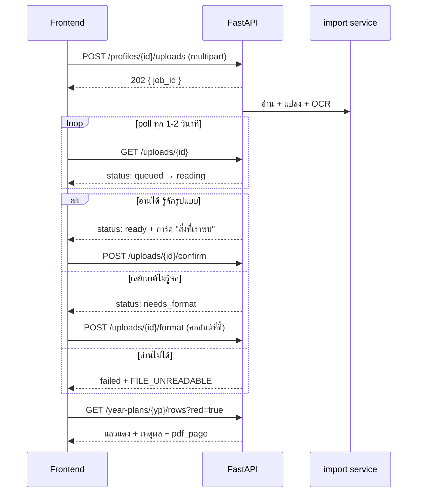
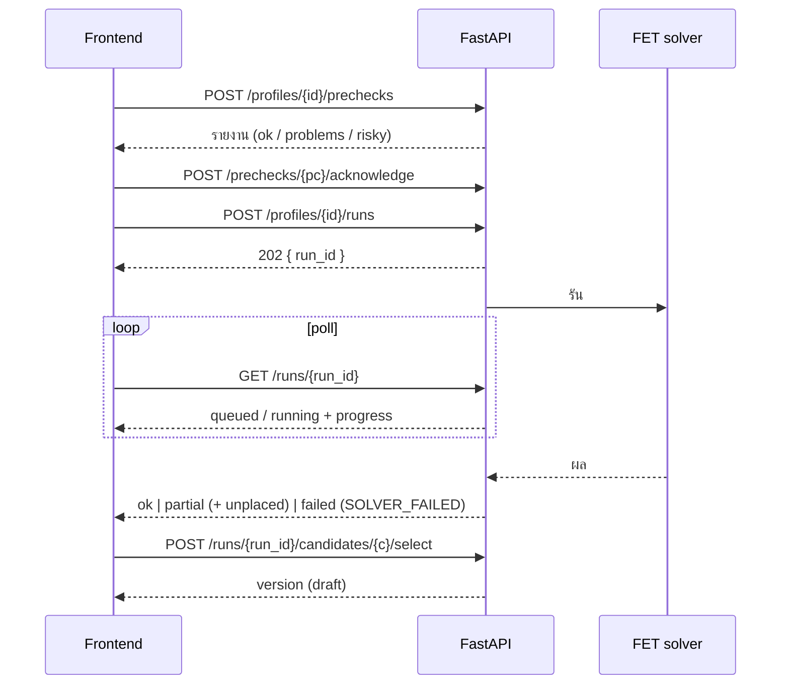
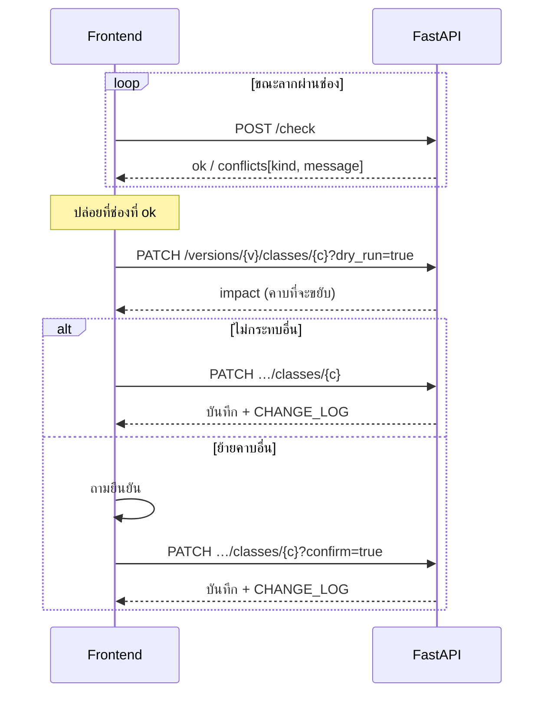
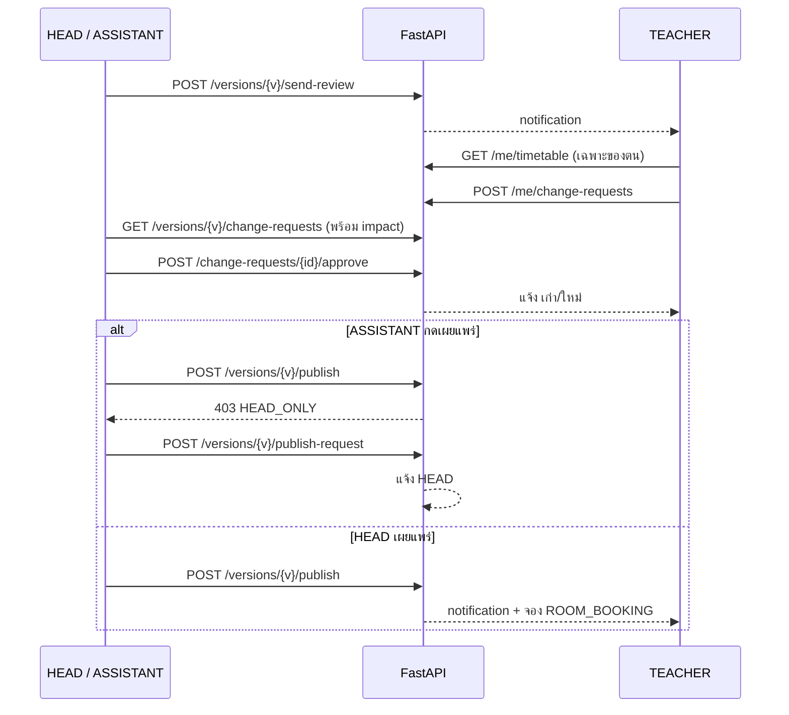

# เส้น API (API routes)

> **ข้อเสนอจากฝั่ง Frontend ให้อานนท์ (FastAPI) ตรวจและปรับ** ไม่ใช่สเปกที่ตกลงแล้ว เอกสารต้นฉบับกำหนดแค่ `POST /api/check` ที่เหลือถอดจาก [flows](flows.md), [หน้าและเส้นทาง](pages-and-routes.md) และ [โมเดลข้อมูล](data-model.md)
> เมื่ออานนท์ทำ Pydantic model เสร็จ ให้ถือ `/openapi.json` เป็นหลัก และแก้ไฟล์นี้ให้ตรง

## 1. ข้อตกลงทั่วไป

| เรื่อง | ข้อเสนอ |
|---|---|
| Base path | `/api` (เวอร์ชันภายหลังเป็น `/api/v2`) |
| รูปแบบ | JSON, UTF-8, ชื่อฟิลด์ `snake_case`, เวลาเป็น ISO 8601 |
| ยืนยันตัวตน | คุกกี้เซสชัน `HttpOnly` (หรือ Bearer) ตามที่ทีมเลือก (decisions O1) |
| สิทธิ์ | ตรวจที่ backend ทุก endpoint คอลัมน์ "ใคร" ด้านล่าง: **A** ADMIN (`user.is_admin` ระดับสถาบัน ไม่ใช่สมาชิกภาควิชา) · **H** HEAD · **S** ASSISTANT · **T** TEACHER · **\*** ทุกคนที่ล็อกอิน |
| ขอบเขตภาควิชา | ผู้ใช้เห็น/แก้ได้เฉพาะภาควิชาที่มี membership ตรวจที่ backend ห้ามเชื่อ Frontend |
| งานนาน | คืน `202 Accepted` + `{ "job_id": … }` แล้วให้ poll `GET …/{id}` (ใช้กับ รัน solver, อ่านไฟล์หลักสูตร, ส่งออก PDF) |
| แก้ข้อมูลที่ล็อก | เวอร์ชัน `published` แก้ไม่ได้ → `409 Conflict` ให้สร้างเวอร์ชันใหม่แทน |
| อัปโหลด | `multipart/form-data` |

### รูปแบบ error (ทุก endpoint)

```json
{
  "error": {
    "code": "PRECHECK_NOT_ACKNOWLEDGED",
    "message": "ต้องรับทราบรายงาน pre-check ก่อนสร้างตาราง",
    "details": { "profile_id": "…" }
  }
}
```

| HTTP | ใช้เมื่อ |
|---|---|
| 400 / 422 | ข้อมูลเข้าไม่ถูกต้อง (FastAPI คืน 422 ให้เอง) |
| 401 | ยังไม่ล็อกอิน / เซสชันหมดอายุ |
| 403 | บทบาทไม่พอ (เช่น ASSISTANT กดเผยแพร่) |
| 404 | ไม่พบ หรือไม่อยู่ในภาควิชาที่เข้าถึงได้ |
| 409 | สถานะไม่อนุญาต (เวอร์ชันล็อก, ขั้นล้าสมัย, ยังมีแถวแดง) |
| 410 | ลิงก์เชิญหมดอายุ |
| 5xx | ระบบผิดพลาด (FET ค้าง → ดู §8) |

**รหัส error ที่ UI ต้องรู้** (ใช้แสดงข้อความตาม [flows → ตารางผิดพลาดรวม](flows.md)):
`INVITE_EXPIRED` · `TERM_NOT_IN_CALENDAR` · `FILE_UNREADABLE` · `RED_ROWS_REMAIN` · `UNKNOWN_LAYOUT` · `ISSUES_UNDECIDED` · `PRECHECK_NOT_ACKNOWLEDGED` · `PRECHECK_IMPOSSIBLE` · `SOLVER_FAILED` · `ROOM_BOOKED` · `VERSION_LOCKED` · `HEAD_ONLY` · `STEP_LOCKED` · `STEP_OUT_OF_DATE`

---

## 2. เข้าสู่ระบบและบัญชี

| Method | Path | ใคร | ใช้ที่ | หมายเหตุ |
|---|---|:-:|---|---|
| GET | `/api/setup/status` | — | 0.0 | `{ "needs_setup": true }` ใช้ตัดสินใจว่าจะแสดงหน้าตั้งค่าครั้งแรกไหม |
| POST | `/api/setup` | — | 0.0 | ชื่อสถาบัน ภาษา ผู้ดูแลคนแรก ใช้ได้ **ครั้งเดียว** หลังนั้น 409 |
| POST | `/api/auth/login` | — | 0.1 | |
| POST | `/api/auth/logout` | * | | |
| POST | `/api/auth/password-reset` | — | 0.2 | ผู้ใช้ขอเอง: ตอบ 202 เสมอ (ไม่บอกว่ามีอีเมลนี้ไหม) ส่งลิงก์ทางอีเมลเฉพาะเมื่อตั้ง SMTP ไม่มี SMTP = ไม่ทำอะไร ให้ติดต่อผู้ดูแล/หัวหน้า |
| POST | `/api/auth/password-reset/confirm` | — | 0.2 | `{ token, new_password }` ลิงก์ใช้ได้ครั้งเดียว หมดอายุ → 410 |
| POST | `/api/admin/users/{id}/reset-link` | A | 0.2 | สร้างลิงก์รีเซ็ต คืน `reset_url` ให้คัดลอกส่งเอง (ส่งอีเมลด้วยเมื่อมี SMTP) |
| POST | `/api/departments/{dep}/people/{user}/reset-link` | H | 2.3 | เหมือนข้างบน **ข้อเสนอ:** หัวหน้าสร้างได้เฉพาะให้ผู้ใช้ที่ไม่ใช่ ADMIN และไม่เป็น HEAD ภาควิชาอื่น (ลิงก์รีเซ็ต = ยึดบัญชีได้ทั้งบัญชี ไม่ใช่แค่ภาควิชานี้) |
| GET | `/api/invites/{token}` | — | 0.3 | บอกภาควิชา บทบาท และว่า `has_account` ไหม (404/410 ถ้าหมดอายุ) |
| POST | `/api/invites/{token}/accept` | — | 0.3 | ผู้ใช้ใหม่ส่งชื่อ+รหัสผ่าน / ผู้ใช้เดิมล็อกอินแล้วเรียกเฉย ๆ |
| GET | `/api/me` | * | แถบบน | ผู้ใช้ + `is_admin` + **memberships** (ภาควิชา + บทบาท) สำหรับตัวสลับ (ถ้า `is_admin` แสดง "ผู้ดูแลสถาบัน" แยก) |
| PATCH | `/api/me` | * | 1.2 | ชื่อ รหัสผ่าน ภาษา (`th`/`en`) ตั้งค่าอีเมล |
| GET | `/api/notifications` | * | 1.1 | `?unread=true` แจ้งในแอปเสมอ ส่งอีเมลเพิ่มเมื่อมี SMTP |
| POST | `/api/notifications/{id}/read` | * | 1.1 | |

## 3. ผู้ดูแลสถาบัน (ADMIN)

| Method | Path | ใคร | ใช้ที่ | หมายเหตุ |
|---|---|:-:|---|---|
| GET | `/api/admin/overview` | A | 3.1 | ภาควิชา: เชิญแล้ว / เข้าร่วม / มีโปรไฟล์ / เผยแพร่ + ว่ามีอัปเดต |
| GET, POST | `/api/admin/departments` | A | 3.2 | |
| PATCH, DELETE | `/api/admin/departments/{id}` | A | 3.2 | |
| POST | `/api/admin/departments/{id}/head-invite` | A | 3.2 | ถ้าไม่ได้ตั้ง SMTP คืน `invite_url` ให้คัดลอก (ไม่ใช่ส่งอีเมล) |
| DELETE | `/api/admin/departments/{id}/head` | A | 3.2 | |
| GET, POST | `/api/admin/shared-rooms` | A | 3.3 | ห้องที่ `department_id` ว่าง |
| PATCH, DELETE | `/api/admin/shared-rooms/{id}` | A | 3.3 | |
| GET, POST | `/api/admin/terms` | A | 3.4 | ภาคเรียน (+ วันหยุด) |
| PATCH, DELETE | `/api/admin/terms/{id}` | A | 3.4 | |
| PUT | `/api/admin/terms/{id}/holidays` | A | 3.4 | ส่งทั้งรายการ |
| GET | `/api/admin/formats` | A | 3.5 | `?status=unverified` |
| GET | `/api/admin/formats/{id}` | A | 3.5 | หน้าตัวอย่าง คอลัมน์ที่หัวหน้าชี้ และสิ่งที่อ่านได้จาก 3 หน้าอื่น |
| POST | `/api/admin/formats/{id}/approve` | A | 3.5 | |
| POST | `/api/admin/formats/{id}/reject` | A | 3.5 | `{ "note": "…" }` หัวหน้าเห็นในขั้น 1 |
| GET | `/api/admin/formats/{id}/export` | A | 3.5 | ไฟล์ definition ส่งให้โครงการ |
| GET | `/api/admin/system` | A | 3.6 | เวอร์ชัน สถานะบริการ บันทึกการรัน solver |
| PUT | `/api/admin/system/smtp` | A | 3.6 | ไม่บังคับ |
| GET, POST | `/api/admin/system/backups` | A | 3.6 | |
| POST | `/api/admin/system/backups/{id}/restore` | A | 3.6 | ย้อนยาก ต้อง confirm ฝั่ง UI |

## 4. ภาควิชา: บุคลากรและห้อง (HEAD / ASSISTANT)

| Method | Path | ใคร | ใช้ที่ | หมายเหตุ |
|---|---|:-:|---|---|
| GET | `/api/departments/{dep}/people` | H S | 2.3 | อาจารย์ + ผู้ช่วย พร้อมสถานะ เชิญแล้ว/เข้าร่วมแล้ว |
| POST | `/api/departments/{dep}/invites` | H S | 2.3 | `role`: `TEACHER` / `ASSISTANT` ผู้ช่วยเชิญ **อาจารย์** ได้ เชิญ **ผู้ช่วย** ได้เฉพาะ H → S เชิญ ASSISTANT = `403` (D12) |
| POST | `/api/departments/{dep}/invites/{id}/resend` | H S | 2.3 | |
| DELETE | `/api/departments/{dep}/people/{user}` | H | 2.3 | ลบหัวหน้าไม่ได้ |
| GET, POST | `/api/departments/{dep}/rooms` | H S | 2.3 | ห้องของภาควิชา (ชื่อ ประเภท ที่นั่ง) |
| PATCH, DELETE | `/api/departments/{dep}/rooms/{id}` | H S | 2.3 | |
| GET | `/api/departments/{dep}/rooms/available` | H S | ขั้น 5 | ห้องของภาควิชา + ห้องร่วม ใช้เลือกตอนตั้งค่า |
| GET | `/api/departments/{dep}/home` | H S | 2.1 | สิ่งที่ต้องทำ: อาจารย์ล่าช้า, blocker, คำขอใหม่, โปรไฟล์ที่ทำค้าง |

## 5. โปรไฟล์และการนำเข้าหลักสูตร (ขั้น 1-2)

| Method | Path | ใคร | ใช้ที่ | หมายเหตุ |
|---|---|:-:|---|---|
| GET | `/api/departments/{dep}/profiles` | H S | 2.2 | ชื่อ ภาคเรียน ชั้นปี สถานะ |
| POST | `/api/departments/{dep}/profiles` | H S | 2.2 | `{ name, term_id, programs[] }` ถ้า `term_id` ไม่อยู่ในปฏิทิน → `TERM_NOT_IN_CALENDAR` |
| POST | `/api/profiles/{id}/copy` | H S | F3 | **คัดลอกจากภาคก่อน** `{ term_id }` เลื่อนชั้นปี เพิ่มกลุ่มปี 1 ใหม่ |
| GET | `/api/profiles/{id}` | H S | 2.4 | รวมสถานะ **ทุกขั้น** (`done` / `current` / `out_of_date` / `locked` + เหตุผลที่ล็อก) และแท็บ หลักสูตร × ชั้นปี ใช้วาด Stepper |
| PATCH | `/api/profiles/{id}` | H S | 2.4 | ชื่อ ภาคเรียน เลือกหลักสูตร (แก้แล้วขั้นหลัง `out_of_date`) |
| DELETE | `/api/profiles/{id}` | H | 2.2 | |
| POST | `/api/profiles/{id}/uploads` | H S | ขั้น 1 | **multipart**: `file`, `program_id` → `202 { job_id }` |
| GET | `/api/uploads/{id}` | H S | ขั้น 1 | สถานะอ่านไฟล์ + การ์ด **"สิ่งที่เราพบ"** (รูปแบบ เวอร์ชันหลักสูตร ชั้นปี ภาคเรียน หน่วยกิต พร้อม `page` ต่อค่า) |
| POST | `/api/uploads/{id}/confirm` | H S | ขั้น 1 | ยืนยันค่าที่ตรวจจับ (ส่งค่าที่แก้ด้วย) |
| POST | `/api/uploads/{id}/format` | H S | 2.4.1 | บันทึกเลย์เอาต์ที่ไม่รู้จัก: คอลัมน์ที่ชี้ → format `unverified` |
| GET | `/api/uploads/{id}/pages/{n}` | H S | ขั้น 2 | ภาพหน้า PDF `?highlight=x,y,w,h` ไฮไลต์ตำแหน่ง |
| GET | `/api/year-plans/{yp}/rows` | H S | ขั้น 2 | แถวแผน + `is_red`, `reason`, `pdf_page`, `bbox` · `?red=true` |
| PATCH | `/api/year-plan-rows/{id}` | H S | ขั้น 2 | แก้ค่า หรือ `{ "accept": true }` (ถูกแล้ว) |
| GET | `/api/year-plans/{yp}/flow` | H S | ขั้น 2 | ข้อมูลผังกระบวนวิชา |
| POST | `/api/year-plans/{yp}/complete-review` | H S | ขั้น 2 | ยังมีแถวแดง → `409 RED_ROWS_REMAIN` พร้อมจำนวน |

`uploads` สถานะ: `queued` → `reading` → `needs_format` | `ready` | `failed` (`FILE_UNREADABLE` + เหตุผล ไม่บันทึกอะไร)

## 6. เวลาว่างและปัญหาข้อมูลอาจารย์ (ขั้น 3-4)

### อาจารย์ (T)

| Method | Path | ใคร | ใช้ที่ | หมายเหตุ |
|---|---|:-:|---|---|
| GET | `/api/me/availability?term_id=` | T | 4.2 | ตารางไม่ว่าง **ครั้งเดียวต่อคน** + ช่อง "ไม่ว่างที่ภาควิชาอื่น" |
| PUT | `/api/me/availability?term_id=` | T | 4.2 | ส่งทั้งตาราง + ชั่วโมงสูงสุด/วัน (เก็บที่ `TEACHER_TERM_SETTING` หนึ่งค่าต่อคนต่อภาค ใช้ร่วมทุกภาควิชา) แก้ได้จนถึงกำหนดส่ง หลังนั้น 409 |
| GET | `/api/me/subject-preferences?dept=&term_id=` | T | 4.2 | วิชาที่ภาควิชาเปิด + อันดับ |
| PUT | `/api/me/subject-preferences?dept=&term_id=` | T | 4.2 | |
| POST | `/api/rounds/{id}/submit` | T | 4.2 | ส่ง → คืนใบรับ (`receipt`: สิ่งที่หัวหน้าจะเห็น) |
| GET | `/api/me/issues` | T | 4.3 | blocker/warning ที่เกี่ยวกับฉัน |

### หัวหน้า / ผู้ช่วย (H S)

| Method | Path | ใช้ที่ | หมายเหตุ |
|---|---|---|---|
| POST | `/api/profiles/{id}/rounds` | ขั้น 3 | เปิดรอบ `{ teacher_ids[], deadline }` → แจ้งอาจารย์ |
| GET | `/api/rounds/{id}` | ขั้น 3 | กระดานสถานะ: `submitted` / `not_yet` / `late` ต่ออาจารย์ |
| POST | `/api/rounds/{id}/remind` | ขั้น 3 | `{ user_ids[]? }` |
| PUT | `/api/rounds/{id}/responses/{user}` | ขั้น 3 | หัวหน้ากรอกแทน หรือ `{ "any_time": true }` บันทึกว่าใครแก้ |
| GET | `/api/profiles/{id}/issues` | ขั้น 4 | ระบบสร้างเอง `?severity=BLOCKER&state=open` |
| GET | `/api/issues/{id}` | ขั้น 4 / 4.3 | พร้อมเธรดความเห็น (ใช้ร่วมกับอาจารย์) |
| POST | `/api/issues/{id}/comments` | H S T | เธรดเดียวกัน อาจารย์ตอบจาก 4.3 |
| POST | `/api/issues/{id}/decision` | H S | `{ outcome, note }` outcome: `assign` · `outside_teacher` · `split` · `accept` · `change` บันทึก ใคร/เมื่อไหร่/ทำไม |
| POST | `/api/profiles/{id}/issues/complete` | H S | มีรายการยังไม่ตัดสินใจ → `409 ISSUES_UNDECIDED` |

## 7. กฎ, pre-check, สร้างตาราง (ขั้น 5-6)

| Method | Path | ใคร | ใช้ที่ | หมายเหตุ |
|---|---|:-:|---|---|
| GET | `/api/profiles/{id}/rules` | H S | ขั้น 5 | กฎ hard (อ่านอย่างเดียว) + soft (เปิด/ปิด + น้ำหนัก) + ตารางเวลา กลุ่ม จำนวนห้อง |
| PUT | `/api/profiles/{id}/rules` | H S | ขั้น 5 | แก้แล้วขั้น 6-9 ของชั้นปีที่เกี่ยวข้อง `out_of_date` |
| PUT | `/api/year-plans/{yp}/electives/{row}` | H S | ขั้น 5 | `{ mode: "SCHEDULE", course_id }` หรือ `{ mode: "RESERVE" }` |
| POST | `/api/profiles/{id}/prechecks` | H S | ขั้น 5 | Check → รายงาน `{ result: ok\|problems\|risky, items[] }` ถ้าเป็นไปไม่ได้ จะมี `reason` + `fix` ("ปี 2 ต้องการ 38 ชม. สัปดาห์มี 30") |
| POST | `/api/prechecks/{id}/acknowledge` | H S | ขั้น 5 | ปลด Generate บันทึกกับการรัน |
| POST | `/api/profiles/{id}/runs` | H S | ขั้น 6 | **Generate** `{ precheck_id, year_plan_id?, pinned_class_ids?[], candidates?: 3 }` → `202 { run_id }` ไม่ acknowledge → `409 PRECHECK_NOT_ACKNOWLEDGED` |
| GET | `/api/runs/{id}` | H S | ขั้น 6 | poll: สถานะ + ผล (ดู §7.1) |
| POST | `/api/runs/{id}/cancel` | H S | ขั้น 6 | ปุ่มยกเลิกระหว่างรัน |
| POST | `/api/runs/{id}/candidates/{c}/select` | H S | ขั้น 6 | เลือกตัวเลือก → สร้างเวอร์ชัน `draft` |

### 7.1 ผลการรัน (`GET /api/runs/{id}`)

```json
{
  "id": "run_1",
  "status": "partial",
  "progress": { "stage": "solving", "percent": 100 },
  "candidates": [
    {
      "id": "c1",
      "score": 82,
      "placed": [
        { "class_id": "k1", "plan_row_id": "r12", "group_id": "g3",
          "teacher_ids": ["u7"], "room_id": "rm4",
          "day": 0, "start_period": 7, "span": 2, "pinned": false }
      ],
      "unplaced": [
        { "class_id": "k9", "plan_row_id": "r30",
          "reason": "อ.ปฐพนพัทธ์ ไม่ว่างทุกคาบที่ห้อง COM603 ว่าง",
          "fix": "ปลดเวลาไม่ว่างวันพฤหัส คาบ 3–4 ของอาจารย์" }
      ]
    }
  ],
  "error": null
}
```

- `status`: `queued` · `running` · `ok` (ครบ) · `partial` (มี `unplaced` **ไม่ใช่ความล้มเหลว**) · `failed` · `cancelled`
- `failed` → `error: { code: "SOLVER_FAILED", message: "ตัวจัดตารางหยุด: <เหตุผล>" }` และ **เก็บผลดีล่าสุดไว้**
- รูปเดียวกับ mock ใน [`frontend/src/api/generate.js`](../../frontend/src/api/generate.js) (ปรับ `placed[]`/`unplaced[]` ให้ตรงเมื่อมีสเปกจริง)

## 8. ตาราง จัดมือ ห้อง ตรวจทาน เผยแพร่ (ขั้น 6-9)

| Method | Path | ใคร | ใช้ที่ | หมายเหตุ |
|---|---|:-:|---|---|
| GET | `/api/versions/{v}` | H S | ขั้น 6-9 | สถานะ (`draft` / `review` / `published`) หมายเลขเวอร์ชัน คะแนน |
| GET | `/api/versions/{v}/classes` | H S | ขั้น 6-7 | `?view=group\|teacher\|room&id=` พร้อมสถานะชน/warning ต่อคาบ |
| **POST** | **`/api/check`** | H S | ขั้น 6 | **ตรวจสดตอนวาง** (มีในสเปกเดิม) ดู §8.1 |
| PATCH | `/api/versions/{v}/classes/{c}` | H S | ขั้น 6-8 | ย้ายคาบ / เปลี่ยนอาจารย์ห้อง / `pinned` ส่ง `?dry_run=true` เพื่อดูผลกระทบโดยไม่บันทึก |
| POST | `/api/versions/{v}/rerun` | H S | ขั้น 6 | รันใหม่รอบ pin `{ year_plan_id }` ที่อื่นถูก pin |
| GET | `/api/versions/{v}/unplaced` | H S | ขั้น 6 | ถาด |
| POST | `/api/versions/{v}/rooms/auto` | H S | ขั้น 7 | วางห้องอัตโนมัติหลังล็อกเวลา |
| POST | `/api/versions/{v}/send-review` | H S | ขั้น 8 | → `review` แจ้งอาจารย์ |
| GET | `/api/versions/{v}/change-requests` | H S | ขั้น 8 | ใคร อะไร เหตุผล **ผลกระทบ** |
| POST | `/api/change-requests/{id}/approve` | H S | ขั้น 8 | รันใหม่แบบน้อยที่สุด (ที่เหลือ pin) แจ้งอาจารย์ + เก่า/ใหม่ |
| POST | `/api/change-requests/{id}/reject` | H S | ขั้น 8 | `{ note }` |
| POST | `/api/versions/{v}/publish` | **H** | ขั้น 9 | ASSISTANT → `403 HEAD_ONLY` เวอร์ชันล็อก แจ้งอาจารย์ทุกคน จอง ROOM_BOOKING |
| POST | `/api/versions/{v}/publish-request` | S | ขั้น 9 | "ขอให้หัวหน้า" → แจ้ง HEAD |
| GET | `/api/profiles/{id}/versions` | H S | 2.4.2 | ทุกเวอร์ชัน + change log |
| POST | `/api/profiles/{id}/versions` | H | 2.4.2 | **เริ่มการเปลี่ยนแปลง** → ร่างเวอร์ชันใหม่จากที่เผยแพร่ |
| GET | `/api/versions/{v}/changelog` | H S T | 2.4.2 | ใคร ค่าเก่า ค่าใหม่ `agreed_with` |
| POST | `/api/versions/{v}/export` | H S | ขั้น 9 | `{ format: "pdf", view: "group\|teacher\|room", id }` → `202 { job_id }` แล้ว `GET /api/exports/{id}` ได้ลิงก์ไฟล์ |
| GET | `/api/versions/{v}/print/{view}/{id}` | H S T | พรีวิว A4 | ข้อมูลสำหรับพรีวิว (หน้าเว็บพิมพ์เอง) |

**Direct edit** ใช้ `PATCH …/classes/{c}` ใน `review` พร้อม `{ "agreed_with": "ชื่อ" }` ถ้าไม่ย้ายคาบอื่นมีผลทันที ถ้าย้ายคาบอื่นคืน `409`-like `{ "needs_confirm": true, "impact": [...] }` ให้ UI ถาม แล้วส่งซ้ำพร้อม `confirm=true` หลังเผยแพร่จะสร้างเวอร์ชันใหม่เสมอ

### 8.1 `POST /api/check` (ตรวจสดตอนวาง)

คำขอ:

```json
{ "version_id": "v3", "class_id": "k1", "day": 1, "start_period": 3, "room_id": "rm4", "teacher_ids": ["u7"] }
```

คำตอบ:

```json
{
  "ok": false,
  "conflicts": [
    { "kind": "TEACHER", "with_class_id": "k5",
      "message": "ชนกับ ป.31901-2001 · อ.ปฐพนพัทธ์ · จันทร์ คาบ 7" }
  ],
  "warnings": [],
  "impact": []
}
```

- `kind`: `TEACHER` · `ROOM` · `GROUP` · `ROOM_BOOKED` (`message` ระบุ "จองโดย <ภาควิชา>") · `HARD_RULE`
- ต้องเร็ว (เรียกทุกครั้งที่ลากผ่านช่องบนตาราง) ไม่บันทึกอะไร

## 9. อาจารย์: ตารางและคำขอ

| Method | Path | ใคร | ใช้ที่ | หมายเหตุ |
|---|---|:-:|---|---|
| GET | `/api/me/timetable?term_id=` | T | 4.4 | **เฉพาะคาบของฉัน** (`draft` ใน REVIEW หรือ `published`) |
| POST | `/api/me/change-requests` | T | 4.4 | `{ version_id, class_id, what, reason }` |
| GET | `/api/me/change-requests` | T | 4.5 | รอ / อนุมัติ / ปฏิเสธ + หมายเหตุ และการเปลี่ยนที่หัวหน้าทำให้ฉัน (เก่า/ใหม่) |
| GET | `/api/me/timetable/export?format=pdf` | T | 4.4 | ตารางของตัวเอง |

---

## 10. ลำดับเรียกที่ Frontend ใช้บ่อย

**สร้างตาราง (ขั้น 5 → 6):**

```
POST /profiles/{id}/prechecks           → รายงาน
POST /prechecks/{pc}/acknowledge
POST /profiles/{id}/runs                → 202 { run_id }
GET  /runs/{run_id}   (poll ทุก 1 วิ จน status ≠ queued/running)
POST /runs/{run_id}/candidates/{c}/select → version
GET  /versions/{v}/classes?view=group&id=g3
```

**ลากคาบ:**

```
(ขณะลาก)  POST /check   → แสดง ✓ / ✕ + เหตุผลทันที
(ปล่อย)   PATCH /versions/{v}/classes/{c}?dry_run=true  → impact
          PATCH /versions/{v}/classes/{c}               → บันทึก (+ CHANGE_LOG)
```

### ลำดับการเรียกเป็นภาพ

**อัปโหลดและอ่านไฟล์หลักสูตร**



**Pre-check → Generate → เลือกตัวเลือก**



**ลากคาบบนตาราง (ตรวจสด → บันทึก)**



**ตรวจทานและเผยแพร่**



## 11. ที่ยังไม่รู้ (ถามอานนท์)

| เรื่อง | ทำไมสำคัญ |
|---|---|
| FET ถูกเรียกอย่างไร และใช้เวลาจริงเท่าไร | ตัดสินว่า `runs` ต้อง async จริงไหม และความถี่ poll |
| `/api/check` ทำงานเร็วพอสำหรับตอนลากหรือไม่ | ถ้าช้า UI ต้อง debounce / ตรวจเฉพาะตอนปล่อย |
| ชนิดของ `class_id` | ต้อง stable ข้ามการรันใหม่ เพื่อให้ pin ใช้ได้ |
| ตัวเลือกยืนยันตัวตน (คุกกี้ หรือ token) | กระทบ CORS และการเก็บเซสชันฝั่ง Frontend |
| `user.is_admin`, `TEACHER_TERM_SETTING`, `PASSWORD_RESET` เพิ่มได้ไหม และย้าย `max_hours_per_day` ออกจาก MEMBERSHIP | ตกลงแล้วฝั่งเรา (decisions D12) ต้องให้ backend รับ |
| การส่งออก PDF ทำที่ backend หรือเบราว์เซอร์พิมพ์ | กระทบ endpoint `export` |

## 12. หมายเหตุสำหรับ FastAPI

- จัดกลุ่มด้วย `APIRouter(prefix=…, tags=[…])` ตามหัวข้อ §2-9 จะได้เอกสาร `/docs` แยกหมวดอ่านง่าย
- ใช้ Pydantic model ทุก request/response (รวม enum สถานะตาม [data-model §3](data-model.md)) ให้ `/openapi.json` เป็นสัญญาจริง
- ตรวจสิทธิ์ด้วย `Depends(require_role(...))` ที่เดียว ไม่เขียนกระจายใน handler
- ตั้ง `CORSMiddleware` (ระหว่างพัฒนา: `http://localhost:5173`) หรือให้ Vite proxy `/api`
- งานนาน (`uploads`, `runs`, `exports`) ใช้ `BackgroundTasks` หรือคิวงาน แล้วเก็บสถานะในตาราง job
