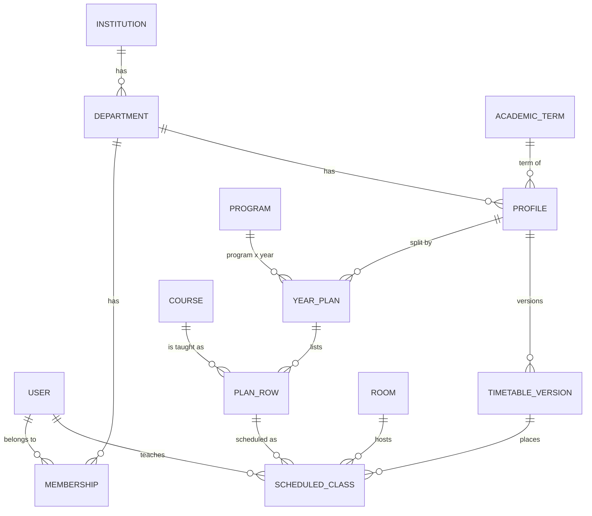
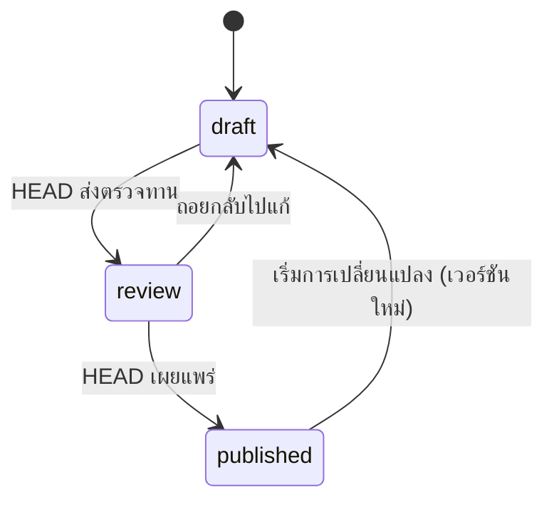

# โมเดลข้อมูล (Data model)

> **ร่างของเรา ไม่ใช่สเปกจากอานนท์** เอกสารต้นฉบับไม่กำหนดตารางข้อมูล ชื่อฟิลด์ และ cardinality ด้านล่างเป็นการตีความจากเอกสาร ต้องให้ทีม backend ยืนยันก่อนใช้จริง

ER เต็ม (35 entity พร้อมฟิลด์): [er-diagram.mmd](../th/6-er-diagram/er-diagram.mmd) · ดูภาพ: [er-diagram.html](../th/6-er-diagram/er-diagram.html)
หน้านี้สรุปแนวคิด สถานะ และข้อกำหนดที่ห้ามผิด

## 1. แกนความสัมพันธ์

## 2. กลุ่มของ entity

| กลุ่ม | Entity | หมายเหตุ |
|---|---|---|
| สถาบัน | INSTITUTION, DEPARTMENT, ACADEMIC_TERM, HOLIDAY, ROOM | ROOM ที่ `department_id` ว่าง = **ห้องร่วม** |
| ผู้ใช้ | USER, MEMBERSHIP (role: HEAD / ASSISTANT / TEACHER), INVITE, PASSWORD_RESET | บทบาทในภาควิชาอยู่ที่ MEMBERSHIP (คนเดียวหลายบทบาท) **ADMIN คือ `user.is_admin` ระดับสถาบัน ไม่อยู่ใน MEMBERSHIP** (decisions D12) |
| หลักสูตร | PROGRAM, CURRICULUM_FORMAT, SOURCE_UPLOAD, COURSE | `og_file` ไม่แก้ `normalised_file` คือไฟล์แปลงแล้ว |
| โปรไฟล์ | PROFILE, YEAR_PLAN, PLAN_ROW, STUDENT_GROUP, ELECTIVE_SLOT | PLAN_ROW มี `pdf_page` และ `is_red` |
| เวลาว่าง | AVAILABILITY_SLOT, TEACHER_TERM_SETTING, SUBJECT_PREFERENCE, ROUND, ROUND_RESPONSE | AVAILABILITY_SLOT และ TEACHER_TERM_SETTING (`max_hours_per_day`) ผูก **USER × ภาคเรียน** ไม่ผูกภาควิชา |
| ปัญหา | ISSUE, COMMENT, DECISION | ISSUE: BLOCKER / WARNING |
| รัน solver | RULE_SETTING, PRECHECK_REPORT, GENERATION_RUN, CANDIDATE | รันต้องอ้าง PRECHECK_REPORT ที่ acknowledge แล้ว |
| ตาราง | TIMETABLE_VERSION, SCHEDULED_CLASS, ROOM_BOOKING | จอง ROOM_BOOKING เมื่อเผยแพร่ |
| เปลี่ยนแปลง | CHANGE_REQUEST, CHANGE_LOG, NOTIFICATION | CHANGE_LOG ไม่มี `request_id` = direct edit |

## 3. สถานะ (enum กลาง)

ใช้ชื่อเดียวกันทั้ง backend, API และ Frontend ตาราง map enum → Badge อยู่ที่จุดเดียว

| Enum | ค่า | เกิดที่ |
|---|---|---|
| `profile.status` | `draft` → `review` → `published` | PROFILE |
| `year_plan.state` | `not_started` · `done` · `out_of_date` | YEAR_PLAN |
| `issue.severity` | `BLOCKER` · `WARNING` | ISSUE |
| `issue.state` | `open` · `closed` | ISSUE |
| `membership.role` | `HEAD` · `ASSISTANT` · `TEACHER` | MEMBERSHIP |
| `elective.mode` | `SCHEDULE` · `RESERVE` | ELECTIVE_SLOT |
| `format.status` | `unverified` · `approved` | CURRICULUM_FORMAT |
| `change_request.status` | `waiting` · `approved` · `rejected` | CHANGE_REQUEST |
| `round_response.status` | `submitted` · `late` · `filled_by_head` · `any_time` | ROUND_RESPONSE |
| `decision.outcome` | `assign` · `outside_teacher` · `split` · `accept` · `change` | DECISION |
| ผลรัน | `ok` · `partial` · `failed` | ข้อเสนอ ยังไม่มีในเอกสาร ต้องตกลงกับอานนท์ |

### วงจรสถานะของ profile

เวอร์ชันที่เผยแพร่แล้ว **ล็อก** แก้ไม่ได้ การเปลี่ยนภายหลังสร้าง TIMETABLE_VERSION ใหม่เสมอ (รวมถึง direct edit)

### กฎ cascade ของสถานะ year plan

แก้ข้อมูลในหนึ่ง year plan → ทำให้ year plan นั้น (และขั้นหลังของมัน) เป็น `out_of_date` **เฉพาะตัวนั้น** ไม่กระทบ year plan อื่น การรันใหม่ก็ทำต่อ year plan โดยที่อื่น pin

### วงจรชีวิตของข้อมูล: จากไฟล์หลักสูตรถึงตารางที่เผยแพร่

```mermaid
flowchart LR
  classDef src fill:#fff4e0,stroke:#f0b45a,color:#1f2937
  classDef core fill:#e8f0fb,stroke:#1f5fae,color:#1f2937
  classDef run fill:#f3f4f6,stroke:#9ca3af,color:#1f2937
  classDef out fill:#e7f6ec,stroke:#166534,color:#1f2937

  UP["SOURCE_UPLOAD<br/>og_file (ไม่แก้)"]:::src --> NORM["normalised_file"]:::src
  NORM --> ROW["PLAN_ROW<br/>+ pdf_page, is_red"]:::core
  ROW --> YP["YEAR_PLAN<br/>หลักสูตร × ชั้นปี"]:::core
  YP --> PROF["PROFILE<br/>ภาควิชา × ภาคเรียน"]:::core

  AV["AVAILABILITY_SLOT<br/>(คน × ภาค)"]:::src --> ISS["ISSUE<br/>BLOCKER / WARNING"]:::core
  PREF["SUBJECT_PREFERENCE"]:::src --> ISS
  ISS --> DEC["DECISION"]:::core

  PROF --> RULE["RULE_SETTING"]:::core
  RULE --> PRE["PRECHECK_REPORT<br/>acknowledge"]:::run
  DEC --> PRE
  PRE --> RUN["GENERATION_RUN"]:::run
  RUN --> CAND["CANDIDATE"]:::run
  CAND --> VER["TIMETABLE_VERSION<br/>draft → review → published"]:::out
  VER --> CLS["SCHEDULED_CLASS"]:::out
  CLS --> BOOK["ROOM_BOOKING<br/>(เมื่อเผยแพร่)"]:::out
  VER --> LOG["CHANGE_LOG<br/>+ CHANGE_REQUEST"]:::out
```

🟧 ข้อมูลนำเข้า · 🟦 ข้อมูลหลักของโปรไฟล์ · ⬜ การรันและตรวจ · 🟩 ผลลัพธ์และบันทึก

## 4. ข้อกำหนดที่ห้ามผิด (invariants)

ใช้ตัดสินใจ constraint ใน DB และ validation ใน API:

1. **หนึ่ง year plan อ่านจาก SOURCE_UPLOAD (หลักสูตรเวอร์ชัน) เดียว** วิชาจึงไม่ปนเวอร์ชันภายในชั้นปี แต่หนึ่ง profile อาจมีหลายเวอร์ชัน
2. **หนึ่ง profile ต่อภาควิชาต่อภาคเรียน** ครอบคลุมทุกหลักสูตรของภาควิชา (ไม่แยกตามหลักสูตร) เพื่อให้ตรวจการชนอาจารย์/ห้องภายใน profile เดียว
3. **เวลาว่างผูกกับคน × ภาคเรียน** (ครั้งเดียว) ใช้ร่วมทุกภาควิชา การจัดอันดับวิชาแยกภาควิชา
4. **ตารางที่บันทึก/เผยแพร่ไม่มีการชนแบบ hard** (อาจารย์ / ห้อง / กลุ่มซ้อนเวลา)
5. **GENERATION_RUN ต้องอ้าง PRECHECK_REPORT ที่ `acknowledged_by` ไม่ว่าง**
6. **ปิด ISSUE ได้ด้วยการมี DECISION เท่านั้น** (`decided_by`, `decided_at`, `note`)
7. **เผยแพร่ได้เฉพาะ HEAD** (`published_by` ต้องมี membership role = HEAD)
8. **`og_file` ห้ามแก้** ทุกการแก้ค่าเป็นการแก้ PLAN_ROW ไม่ใช่ไฟล์
9. **ทุกการเปลี่ยนตารางมี CHANGE_LOG** (ใคร ค่าเก่า ค่าใหม่ `agreed_with` ถ้ามี) ผ่าน project service ตัวเดียว (N1)
10. **วันที่ภาคเรียนมาจาก ACADEMIC_TERM เท่านั้น** ไม่อ่านจากไฟล์หลักสูตร
11. **ห้องร่วมจองซ้ำไม่ได้ข้ามภาควิชา** ROOM_BOOKING ตรวจตอนยืนยันห้อง (ขั้น 7) และเผยแพร่
12. **ไม่มีข้อมูลนักศึกษา** ไม่มี entity ของนักศึกษา (STUDENT_GROUP คือกลุ่มเรียน ไม่ใช่คน)

## 5. ข้อมูลที่ Frontend ต้องการจาก API (ขั้นต่ำสำหรับ MVP)

ยังไม่มี data contract จริง จึงระบุแค่เนื้อหา ไม่ระบุรูปแบบ:

| หน้าจอ | ต้องการ |
|---|---|
| ตาราง | SCHEDULED_CLASS + PLAN_ROW + COURSE (รหัส ชื่อ ท-ป-น) + ห้อง + อาจารย์ + `pinned` + สถานะชน/WARNING พร้อมคาบคู่ชน |
| ถาด "ยังไม่ลง" | คาบที่ไม่ได้ลง + `reason` + `suggested_fix` |
| ผลรัน | `status` (ok/partial/failed), คะแนนคุณภาพ, ตัวเลือก N แบบ, ความคืบหน้า |
| ตรวจสด | คำถาม "วางคาบ X ที่ (วัน, คาบ) ได้ไหม" → ok หรือเหตุผล (`POST /api/check`) |
| ตรวจข้อมูล | PLAN_ROW + `is_red` + เหตุผล + `pdf_page` + ภาพครอบหน้า |
| ผลกระทบของการแก้ | จำนวนและรายการคาบที่จะขยับ |
