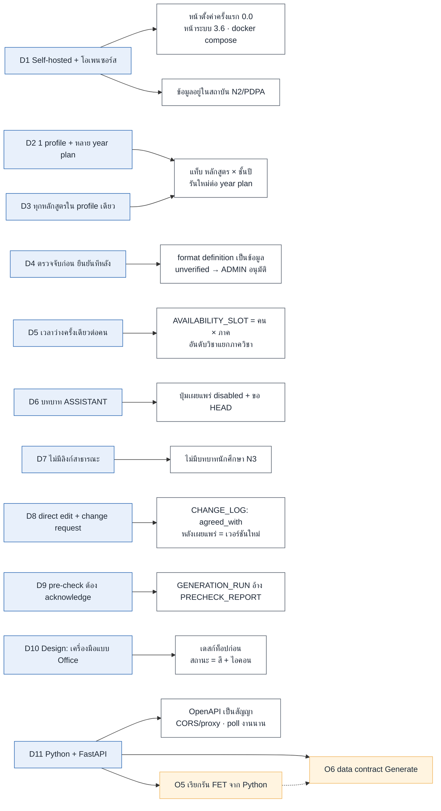

# บันทึกการตัดสินใจ (Decision log)

รวมการตัดสินใจที่กระจายอยู่ในต้นฉบับ แต่ละข้อมี **บริบท → ตัดสินใจ → เหตุผล** เรียงตามหัวข้อ
วันที่ตามต้นฉบับ (2026-10-24 เป็นวันตัดสินใจส่วนใหญ่)

## ที่ตัดสินใจแล้ว

### D1 Self-hosted และโอเพนซอร์ส
- **ตัดสินใจ** แต่ละสถาบันติดตั้งและรันสำเนาของตนเอง ไม่มีผู้ดูแลแพลตฟอร์มกลาง
- **เหตุผล** ข้อมูลอาจารย์ไม่ออกนอกสถาบัน (N2/PDPA) โครงการโอเพนซอร์สส่งโค้ดกับรูปแบบหลักสูตรที่ใช้ร่วม แต่ไม่เห็นข้อมูล
- **ผลต่อโค้ด** ต้องมีหน้าตั้งค่าครั้งแรก (0.0), หน้าระบบ (3.6: สำรองข้อมูล SMTP), ติดตั้งด้วย `docker compose up`

### D2 หนึ่ง profile ต่อภาควิชาต่อภาค มีหลาย year plan
- **บริบท** PDF หลักสูตร 5 ปี ควรเป็น 1 profile หรือ 5 profile
- **ตัดสินใจ** 1 profile ต่อภาควิชาต่อภาค ภายในมี year plan ต่อ หลักสูตร × ชั้นปี
- **เหตุผล** อาจารย์และห้องชุดเดียวกันรองรับทุกชั้นปีพร้อมกัน แยก profile จะตรวจการชนข้าม profile ซึ่งเปราะที่สุด และเสียหนึ่งการตรวจทาน/เผยแพร่/เวอร์ชันให้เหลือ 5 อันที่อาจเพี้ยนกัน
- **ผลต่อโค้ด** แท็บ หลักสูตร × ชั้นปี สถานะแยกต่อ year plan รันใหม่ต่อ year plan (ที่อื่น pin) คัดลอกจากภาคก่อนให้ year plan เลื่อนขึ้นตามนักศึกษา
- **แก้การตัดสินใจเดิม** เดิมใน `tech-stack-list.txt` คือ "1 profile = 1 เวอร์ชันหลักสูตร" ตอนนี้ 1 year plan = 1 เวอร์ชันหลักสูตร

### D3 ทุกหลักสูตรของภาควิชาใน profile เดียว
- **ตัดสินใจ** ค.บ., เทียบโอน, ศษ.ม., ปร.ด. อยู่ใน profile เดียว (แท็บ = หลักสูตร × ชั้นปี)
- **เหตุผล** อาจารย์และห้องใช้ร่วมกันข้ามหลักสูตร

### D4 ตรวจจับก่อน ยืนยันทีหลัง (ไม่ให้เลือกรูปแบบเอง)
- **ตัดสินใจ** ระบบอ่านไฟล์แล้วเติมค่า ผู้ใช้ยืนยัน/แก้ พร้อมหลักฐานต่อค่า เลย์เอาต์ไม่รู้จัก → ผู้ใช้ชี้คอลัมน์ → บันทึกเป็น format definition
- **เหตุผล** เลือกรูปแบบผิด = ตั้งค่าผิดทั้งหมดต่อจากนั้น และต้องรองรับหลักสูตรชนิดใหม่โดยไม่ต้องมีโปรแกรมเมอร์
- **ผลต่อโค้ด** format definition เป็น **ข้อมูล** ไม่ใช่โค้ด (เปลี่ยนเลย์เอาต์ไม่ต้องอัปเดตระบบ มีแต่ระบบหน่วยกิตใหม่จริงที่ต้องเขียนโค้ด) เริ่มเป็น `unverified` จน ADMIN อนุมัติ

### D5 เวลาว่างครั้งเดียวต่อคน
- **ตัดสินใจ** ใช้ร่วมทุกภาควิชา HEAD เห็น "ไม่ว่างที่ภาควิชาอื่น" การจัดอันดับวิชาแยกภาควิชา
- **เหตุผล** อาจารย์สอนข้ามภาควิชาได้ ถามซ้ำเสียเวลาและเสี่ยงข้อมูลขัดกัน

### D6 บทบาท ASSISTANT
- **ตัดสินใจ** หน้าเดียวกับ HEAD ทำขั้น 1-8 ได้ แต่เผยแพร่ ลบ HEAD เชิญผู้ช่วยคนอื่นไม่ได้
- **ผลต่อโค้ด** ปุ่มเผยแพร่ของ ASSISTANT disabled + เหตุผล + ปุ่มขอ HEAD ทุกการเปลี่ยนบันทึกว่าใครทำ

### D7 ไม่มีลิงก์สาธารณะสำหรับนักศึกษา
- **ตัดสินใจ** อาจารย์แจกตารางที่พิมพ์/PDF เอง ไม่มีบทบาทนักศึกษา (N3)

### D8 Direct edit ควบคู่ change request
- **บริบท** หัวหน้ากับอาจารย์มักตกลงเรื่องเล็กต่อหน้า การให้ยื่นคำขอเป็นภาระ
- **ตัดสินใจ** ใน REVIEW HEAD แก้ตรง ๆ ได้ พร้อม "ตกลงกับ ___" แจ้งอาจารย์ที่ได้รับผลกระทบ แก้ที่ย้ายคาบอื่นถามก่อน คำขอแบบเป็นทางการคงไว้สำหรับอาจารย์ที่ไม่ได้คุยกับหัวหน้าหรือการเปลี่ยนใหญ่
- **ผลต่อโค้ด** หลังเผยแพร่ direct edit สร้างเวอร์ชันใหม่เสมอ

### D9 Pre-check ต้อง acknowledge
- **ตัดสินใจ** ก่อน Generate ต้องกดรับทราบรายงาน pre-check การรับทราบถูกบันทึกกับการรัน

### D10 Design system: เครื่องมือแบบ Office ไม่ใช่ Dashboard
- **ตัดสินใจ** ตารางเป็นพระเอก UI อื่นเป็นแถบเครื่องมือรอบตาราง เดสก์ท็อปก่อน (≥1280px เต็ม; <1024px อ่านอย่างเดียว)
- **ผลต่อโค้ด** สถานะ = สี + ไอคอน/ข้อความเสมอ ไม่พึ่งสีอย่างเดียว ดู [design-system.md](../th/7-design-system/design-system.md)

### D11 Backend ใช้ Python + FastAPI
- **ตัดสินใจ** อานนท์ใช้ Python ทำ API (FastAPI) และจัดการเอกสาร (นำเข้า/แปลงไฟล์หลักสูตร)
- **เหตุผล** FastAPI สร้างสเปก OpenAPI อัตโนมัติ ใช้เป็น data contract ระหว่าง backend กับ Frontend ได้ และ Python มีเครื่องมือ PDF/OCR พร้อม
- **ผลต่อโค้ด** Frontend อ่านสเปกจาก `/openapi.json` เพื่อสร้าง type/client; ตั้ง CORS หรือ proxy ใน `vite.config.js`; อัปโหลดไฟล์เป็น `multipart/form-data`; งานนานใช้ background task + poll สถานะ; mock ที่ `frontend/src/api/generate.js` ต้องมีรูปเดียวกับสเปกจริงเมื่ออานนท์ส่งมา

### D12 บทบาทและบัญชี (ตกลง 2026-10-27)
- **ตัดสินใจ**
  1. **ADMIN** เป็นสิทธิ์ระดับสถาบันติดกับบัญชี (`user.is_admin`) ไม่ใช่สมาชิกแผนก (`MEMBERSHIP` มี `department_id` เป็นส่วนของ PK ใส่ ADMIN ไม่ได้) บัญชีเดียวเป็น ADMIN และ HEAD/TEACHER พร้อมกันได้ ตัวสลับแสดง "ผู้ดูแลสถาบัน" แยกจากภาควิชา
  2. **ชั่วโมงสอนสูงสุดต่อวัน** เป็นหนึ่งค่าต่อคนต่อภาคเรียน (เหมือนเวลาว่าง) เก็บที่ `TEACHER_TERM_SETTING` ไม่ใช่ต่อภาควิชา
  3. **ชื่อบทบาท** ใช้ `ASSISTANT` ทั้งโค้ดและ API หน้าจอเรียก "ผู้ช่วย"
  4. **รีเซ็ตรหัสผ่าน (0.2)** ผู้ดูแลสถาบันหรือหัวหน้าสร้างลิงก์รีเซ็ตให้คัดลอกส่งเอง (แบบเดียวกับลิงก์เชิญ) และส่งอีเมลด้วยเมื่อมี SMTP
  5. **แจ้งเตือน (เดิม O2)** ในแอปเสมอ ส่งอีเมลเมื่อมี SMTP **การเชิญ (เดิม O3)** ผู้ช่วยเชิญอาจารย์ได้ ส่วนการเชิญผู้ช่วยยังเฉพาะหัวหน้า
  6. **wireframe ที่ขาด** (0.2, 1.2, 2.4.1) ร่างใน [wireframes-missing.md](wireframes-missing.md)
- **ผลต่อโค้ด** ตัวสลับต้องรู้ทั้ง `memberships` และ `is_admin`; `GET /api/me` คืนทั้งสองอย่าง; ตาราง/ฟิลด์ใหม่ที่ต้องให้อานนท์เพิ่ม: `user.is_admin`, `TEACHER_TERM_SETTING`, `PASSWORD_RESET`; ย้าย `max_hours_per_day` ออกจาก `MEMBERSHIP`
- **ที่ยังเปิด** O1 วิธีล็อกอิน (บัญชีในตัวเป็นข้อเสนอที่ไม่มีใครคัดค้าน แต่ยังไม่ถูกตัดสินเป็นทางการ)

### D13 TypeScript และสีหลัก (2026-10-27)
- **ตัดสินใจ** ใช้ TypeScript (strict) ทั้ง `frontend/src` ปิด O7 · สีหลักคือ **เหล็กเงิน `#3d556f`** ตามที่ผู้ใช้สั่ง (ธีมขาว-เงิน) ปิด O10 และสถานะ "ต้องแก้" ใช้ส้ม (warning)
- **ผลต่อโค้ด** `tsc --noEmit` อยู่ใน `npm run build` · type ฝั่ง API อยู่ `src/api/types.ts` และเข้า UI ผ่านตัวแปลงเท่านั้น (ตอนนี้เขียนมือ จะเปลี่ยนเป็น generate จาก `/openapi.json` ตาม T4.1) · ตัวเลือกยืนยันตัวตน (คุกกี้/token) ยังเปิด จึงใช้ mock ที่ `src/api/auth.ts`

### แผนภาพ: การตัดสินใจกับสิ่งที่ได้รับผลกระทบ

ฟ้า = ตัดสินใจแล้ว · ส้ม = ยังเปิด (ขึ้นกับอานนท์)

## ที่ยังเปิดอยู่

| # | เรื่อง | ข้อเสนอในเอกสาร / ทางเลือก | ใครตัดสิน |
|---|---|---|---|
| O1 | วิธีล็อกอิน | บัญชีในตัว (ไม่พึ่งบริการภายนอก); SSO สถาบัน = ภายหลัง | ทีม |
| O4 | **หน้า "ตรวจทานตารางที่สกัดได้" (OCR จากรูปตาราง) อยู่ใน MVP ไหม** | design system ใส่ไว้ใน MVP แต่ user-flows ไม่มี flow นี้ (มีแต่ตรวจไฟล์หลักสูตร) ต้องยืนยัน | อานนท์ + เรา |
| O5 | วิธีเรียกรัน FET จาก Python และเวลาที่ใช้จริง | (ภาษา/framework ตัดสินใจแล้ว ดู D11) | อานนท์ |
| O6 | data contract ของ Generate (input / output / error) | ให้อานนท์กำหนด Pydantic model แล้วเราอ่านจาก `/openapi.json` (D11) ข้อกำหนดเชิงพฤติกรรมอยู่ใน [requirements §7](requirements.md) | อานนท์ + เรา |
| O8 | วิธีป้อนข้อมูลใน MVP | ฟอร์ม / อัปโหลด CSV-Excel / ข้อมูลตัวอย่างคงที่ | เรา |
| O9 | ขอบเขตหลายภาควิชาและห้องร่วมใน MVP | ภาควิชาเดียวก่อน ตามที่เดโมใช้ข้อมูล มจพ. | ทีม |

## ค้างอยู่ (งานที่ต้องทำ)

| เรื่อง | รายละเอียด |
|---|---|
| `tech-stack-list.txt` | สเปกเทคนิคฉบับเต็มที่ต้นฉบับอ้างถึง ไม่อยู่ในชุดนี้ ขอจากอานนท์เพื่อเติมส่วน backend ใน [tech stack](../th/8-tech-stack.md) |

## การเปลี่ยนสเปกที่ sitemap บ่งชี้ (ต้นฉบับยังไม่ได้ปรับ)

- แถบขั้น 9 ขั้น แทน 7 ขั้นใน "TOP BAR" ของ `tech-stack-list.txt`: Detect รวมเข้า Setup; Availability, Teacher input, Teacher review เป็นขั้นใหม่
- อาจารย์และห้องย้ายออกจาก "สร้างโปรไฟล์" ไปหน้าภาควิชา (2.3) โปรไฟล์เพียงเลือกจากที่นั่น
- ADMIN ได้หน้าปฏิทิน (3.4), รูปแบบ (3.5), ระบบ (3.6) และไม่มีผู้ดูแลแพลตฟอร์ม
