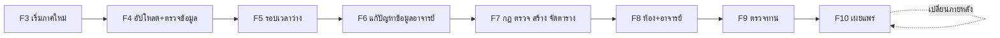
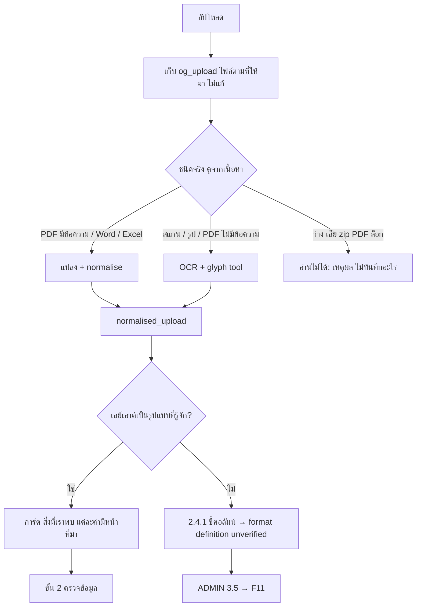
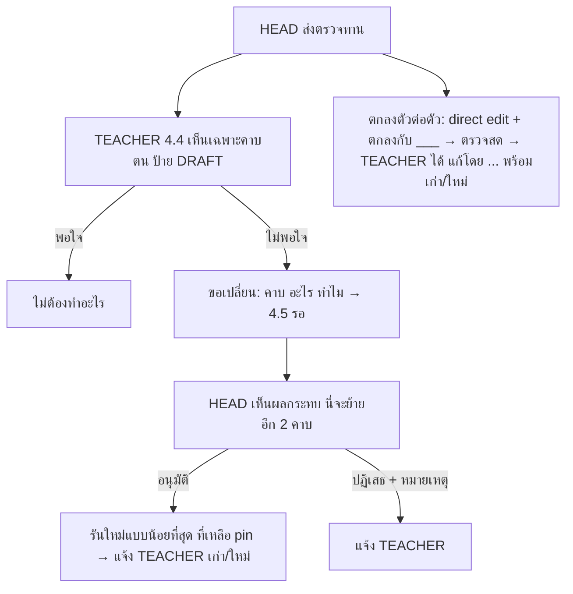

# Flows

เรียบเรียงจาก user-flows 12 งาน แต่ละงานระบุ **ผู้ทำ · เริ่มที่ · ขั้นตอน · ผลลัพธ์ · กรณีผิดพลาด** เพื่อใช้เขียน state, validation และ error handling
เลขหน้า (เช่น `2.4`) ดู [pages-and-routes.md](pages-and-routes.md)
ภาพต้นฉบับ: [`doc/4-user-flows/flows/F1…F12.png`](../4-user-flows/flows/)

บทบาท: ADMIN · HEAD · ASSISTANT (หน้าเดียวกับ HEAD แต่เผยแพร่ไม่ได้) · TEACHER

## ภาพรวมวงจรหนึ่งภาคเรียน

---

## ความสัมพันธ์ระหว่าง flow

```mermaid
flowchart LR
  classDef adm fill:#fff4e0,stroke:#f0b45a,color:#1f2937
  classDef head fill:#e8f0fb,stroke:#1f5fae,color:#1f2937
  classDef both fill:#e7f6ec,stroke:#166534,color:#1f2937

  F1["F1 ตั้งค่าสถาบัน"]:::adm
  F2["F2 เข้าร่วมด้วยคำเชิญ"]:::both
  F3["F3 เริ่มภาคใหม่"]:::head
  F4["F4 อัปโหลด+อ่านไฟล์"]:::head
  F5["F5 รอบเวลาว่าง"]:::both
  F6["F6 ปัญหาข้อมูลอาจารย์"]:::both
  F7["F7 กฎ/สร้าง/จัดตาราง"]:::head
  F8["F8 ห้องและอาจารย์"]:::head
  F9["F9 ตรวจทาน"]:::both
  F10["F10 เผยแพร่"]:::head
  F11["F11 อนุมัติรูปแบบ"]:::adm
  F12["F12 มอบงานผู้ช่วย"]:::head

  F1 -->|"เชิญ HEAD"| F2
  F2 --> F3 --> F4 --> F5 --> F6 --> F7 --> F8 --> F9 --> F10
  F4 -.->|"เลย์เอาต์ไม่รู้จัก"| F11
  F11 -.->|"ส่งกลับ"| F4
  F12 -->|"เชิญผู้ช่วย"| F2
  F10 -.->|"เปลี่ยนภายหลัง"| F9
  F2 -.->|"เชิญอาจารย์"| F5
```

เส้นทึบ = ลำดับปกติ · เส้นประ = ทางแยกหรือวนกลับ · 🟧 ADMIN · 🟦 HEAD/ASSISTANT · 🟩 ใช้ร่วมกับ TEACHER

## F1 ตั้งค่าสถาบัน
**ผู้ทำ** ADMIN (ครั้งเดียว) · **เริ่ม** `docker compose up` → 0.0

1. 0.0 ตั้งค่าครั้งแรก: ชื่อสถาบัน ภาษา บัญชีผู้ดูแลคนแรก → 3.1
2. 3.4 ปฏิทิน: ภาคเรียน + วันหยุด
3. 3.2 เพิ่มภาควิชา → เชิญ HEAD
   - ตั้ง SMTP ใน 3.6 แล้ว → ส่งอีเมล
   - ยังไม่ตั้ง → หน้าแสดง **ลิงก์เชิญ** ให้คัดลอกส่งเอง
4. 3.3 ห้องร่วม

**ผลลัพธ์** 3.1 แสดงแต่ละภาควิชา: เชิญแล้ว / เข้าร่วมแล้ว / มีโปรไฟล์ / เผยแพร่แล้ว
**ผิดพลาด** HEAD ไม่ยอมรับเชิญ → 3.2 แสดง "เชิญเมื่อ 7 วันก่อน" + ส่งอีกครั้ง

## F2 เข้าร่วมด้วยคำเชิญ
**ผู้ทำ** HEAD / ASSISTANT / TEACHER · **เริ่ม** 0.3

| มีบัญชีแล้ว? | ทำ |
|---|---|
| ใช่ | ล็อกอิน → ภาควิชาใหม่ถูกเพิ่มในตัวสลับภาควิชา |
| ไม่ | ตั้งชื่อ + รหัสผ่าน → สร้างบัญชี |

**ผลลัพธ์** ไปหน้าแรกของบทบาทที่ถูกเชิญ (2.1 หรือ 4.1) ครั้งแรกมีแนะนำ 3 ขั้น
**ผิดพลาด** ลิงก์หมดอายุ → "ขอให้หัวหน้า/ผู้ดูแลส่งใหม่" ไม่สร้างบัญชี

## F3 เริ่มตารางเรียนภาคนี้
**ผู้ทำ** HEAD / ASSISTANT · **เริ่ม** 2.1 "เริ่มตารางเรียนภาคนี้"

1. มีโปรไฟล์ภาคก่อน?
   - ใช่ → 2.2 **คัดลอกจากภาคก่อน** (เก็บบุคลากร ห้อง กฎ หลักสูตร; ชั้นปีเลื่อนขึ้น 1 ปี; เพิ่มกลุ่มปี 1 ใหม่)
   - ไม่ → 2.2 ใหม่
2. 2.4 ขั้น 1: เลือกภาคเรียนจากปฏิทิน (ไม่เอาจากไฟล์)
3. เลือกหลักสูตรที่สอนในภาคนี้ (ค.บ. / เทียบโอน / ศษ.ม. / ปร.ด. …)
4. อัปโหลดไฟล์หลักสูตรต่อหลักสูตร (PDF, Word, Excel, สแกน, รูปถ่าย) → F4

**ผลลัพธ์** พื้นที่ทำงานมี 1 แท็บต่อ หลักสูตร × ชั้นปี ทุกขั้น "ยังไม่เริ่ม"
**ผิดพลาด** ภาคเรียนไม่อยู่ในปฏิทิน → "ขอให้ผู้ดูแลเพิ่ม" (3.4) HEAD พิมพ์วันที่เองไม่ได้

## F4 อัปโหลดและอ่านไฟล์หลักสูตร
**ผู้ทำ** HEAD / ASSISTANT · **เริ่ม** 2.4 ขั้น 1

ขั้น 2 ตรวจข้อมูล (ต่อ หลักสูตร × ชั้นปี, ตาราง | ผังกระบวนวิชา):
- ค่าที่ตัวอ่าน **มั่นใจ** แสดงปกติ ค่าที่ **ไม่มั่นใจ** เป็นแดงพร้อมเหตุผลและภาพครอบหน้า
- "แถวแดงถัดไป" → ไฟล์เปิดข้างตาราง ไฮไลต์ตำแหน่ง → แก้ค่า หรือ "ถูกแล้ว"
- ยังมีแดง → ปุ่มไปต่อล็อก ("เหลือ 3 ค่าที่ต้องการคุณ")

**ผลลัพธ์** ทุกแถวของแผนมี: หลักสูตร ชั้นปี ภาคเรียน รหัส (หรือ "slot") ชื่อ หน่วยกิต L-P-S
**ผิดพลาด**
- วิชาเดียวกันอ่านต่างกันระหว่าง "แผน" กับ "รายการวิชา" → แดง แสดงสองค่า ให้ HEAD เลือก
- อัปโหลดไฟล์ใหม่ทับ → ขั้นหลังจากนั้น **ล้าสมัยเฉพาะหลักสูตรนั้น**

## F5 รอบเวลาว่าง
**ผู้ทำ** HEAD/ASSISTANT เปิดรอบ · TEACHER ตอบ

**HEAD** (2.4 ขั้น 3): เลือกอาจารย์ของภาคนี้จาก 2.3 → ตั้งกำหนดส่ง → เปิดรอบ → อาจารย์ได้แจ้งเตือน (1.1 + อีเมลถ้าตั้ง)

**TEACHER** (4.1 → 4.2):
- ภาคนี้กรอกให้ภาควิชาอื่นแล้ว? → แสดงตารางเดิม (ครั้งเดียวต่อคน); มีแต่ **การจัดอันดับวิชา** ที่แยกตามภาควิชา
- ยังไม่เคย → คลิกเวลาไม่ว่างบนตารางรายสัปดาห์ + จัดอันดับวิชา + ชั่วโมงสูงสุด/วัน
- ส่ง → ใบรับ ("ส่งแล้ว หัวหน้าเห็น …") แก้ได้จนกำหนด

**HEAD ติดตาม:** กระดาน ส่งแล้ว / ยังไม่ส่ง / ล่าช้า → ส่งเตือน เลยกำหนดแล้วมีคนขาด → กรอกแทน หรือ "ว่างได้ทุกเวลา"

**ผลลัพธ์** ขั้น 3 เสร็จเมื่อ **ทุกอาจารย์ที่เลือกมีคำตอบ**
**ผิดพลาด** เวลาไม่ว่างเปลี่ยนหลังกำหนด → อาจารย์ขอ HEAD; HEAD แก้ (บันทึก)

## F6 แก้ปัญหาจากข้อมูลอาจารย์
**ผู้ทำ** HEAD/ASSISTANT · TEACHER ให้ความเห็น · **เริ่ม** 2.4 ขั้น 4

ระบบสร้างรายการเอง:

| ชนิด | ตัวอย่าง | ทางแก้ |
|---|---|---|
| BLOCKER | วิชาที่ไม่มีใครสอนได้ | มอบอาจารย์ / ทำเครื่องหมาย "อาจารย์ภายนอก / ต้องจ้าง" / แบ่งกลุ่ม |
| BLOCKER | อาจารย์สองคนอยากสอนวิชาเดียว | เลือกคนเดียว / แบ่งกลุ่มให้ทั้งสอง |
| WARNING | ชั่วโมงของวิชาเกินเวลาว่างของอาจารย์ | แก้ หรือ **ยอมรับ + หมายเหตุ** |

- เปิดรายการ → เธรดความเห็น (TEACHER เห็นที่ 4.3 และตอบที่นั่น)
- ปิดรายการได้ด้วยการตัดสินใจ บันทึก **ใคร เมื่อไหร่ ทำไม**
- ยังมีรายการไม่ตัดสินใจ → ขั้น 4 ยังเปิด

**ผลลัพธ์** ทุกวิชามีอาจารย์ (หรืออาจารย์ภายนอกที่ทำเครื่องหมาย)

## F7 กฎ ตรวจ สร้าง จัดตาราง
**ผู้ทำ** HEAD/ASSISTANT · **เริ่ม** 2.4 ขั้น 5

**ขั้น 5 (กฎ):**
- ตารางเวลา (จากโปรไฟล์), กลุ่มต่อ หลักสูตร × ชั้นปี, จำนวนห้อง (**ต้องมีก่อนจัดตาราง**)
- วิชาเลือกแต่ละช่อง → **Schedule** (เลือกวิชา) หรือ **Reserve** (เก็บชั่วโมงว่าง)
- กฎ soft: เปิด/ปิด + น้ำหนัก · กฎ hard (จากหลักสูตร): แสดงแต่แก้ไม่ได้
- Check → รายงาน pre-check (OK / ปัญหา / กฎเสี่ยง)
  - เป็นไปไม่ได้เมื่อนับดู → เหตุผล + วิธีแก้ใกล้สุด (เช่น "ปี 2 ต้องการ 38 ชม. สัปดาห์มี 30") → กลับไปกฎ
  - ผ่าน → **Acknowledge** → Generate ปลดล็อก (การรับทราบถูกบันทึกกับการรัน)

**ขั้น 6 (Generate):**
- ได้ตัวเลือกที่ดีที่สุด + คะแนนคุณภาพ
- ลงครบ → ตาราง · ไม่ครบ → **ตารางบางส่วน + ถาด** (แต่ละคาบมีเหตุผล + วิธีแก้ใกล้สุด)
- ลากคาบ → ตรวจสดตอนวาง: OK หรือช่องแดง + เหตุผล
- Pin คาบที่ตกลง · รันใหม่รอบ pin (ขยับเฉพาะ หลักสูตร × ชั้นปีนั้น)
- อาจารย์ที่ไม่ว่างในภาควิชาอื่น แสดงเป็นช่องเทา "ไม่ว่างที่อื่น"

**ผลลัพธ์** ทุกคาบมีเวลา ไม่ฝ่าฝืนกฎ hard
**ผิดพลาด** FET ค้างหรือแครช → "ตัวจัดตารางหยุด: <เหตุผล>" **เก็บผลดีล่าสุดไว้**

## F8 ห้องและอาจารย์
**ผู้ทำ** HEAD/ASSISTANT · **เริ่ม** 2.4 ขั้น 7

1. เวลาล็อกแล้ว → วางห้องอัตโนมัติ (เฉพาะห้องของ FET)
2. ต่อคาบ: ยืนยันอาจารย์ → ตรวจการชนต่อการมอบหมาย
   - ห้องร่วมถูกภาควิชาอื่นจองแล้ว → แดงที่คาบนั้น + "จองโดย <ภาควิชา>"
3. พรีวิว A4 ด้านล่างเปลี่ยนสด (1 ตารางต่อกลุ่ม ต่ออาจารย์/ห้องได้ด้วย)

**ผลลัพธ์** ทุกคาบมีห้องและอาจารย์ พรีวิวเหมือนกระดาษที่พิมพ์

## F9 ตรวจทานและการเปลี่ยนแปลง
**ผู้ทำ** HEAD/ASSISTANT · TEACHER · **เริ่ม** 2.4 ขั้น 8

**ผลลัพธ์** ไม่มีคำขอค้าง (หรือ HEAD ตัดสินใจเผยแพร่เลย; คำขอที่ค้างยังเห็นอยู่)

## F10 เผยแพร่และเปลี่ยนภายหลัง
**ผู้ทำ** HEAD เท่านั้น · **เริ่ม** 2.4 ขั้น 9

- ASSISTANT กดเผยแพร่ → "มีแต่หัวหน้าที่เผยแพร่ได้" + ขอให้หัวหน้า → HEAD ได้แจ้งเตือน
- เผยแพร่ → **เวอร์ชัน 1 ล็อก** แจ้งอาจารย์ทุกคน ดาวน์โหลด/พิมพ์ต่อกลุ่ม อาจารย์ ห้อง
- ภายหลัง: 2.4.2 "เริ่มการเปลี่ยนแปลง" → ร่างเวอร์ชันใหม่ (เวอร์ชันที่เผยแพร่ยังใช้ได้) → ตรวจผลกระทบ + เปลี่ยนน้อยสุด → เผยแพร่ → เวอร์ชัน 2 แจ้งเฉพาะอาจารย์ที่ได้รับผลกระทบ

**ผลลัพธ์** นักศึกษาได้ตารางใหม่จากอาจารย์ (ไม่มีล็อกอิน ไม่มีลิงก์สาธารณะ)

## F11 อนุมัติรูปแบบใหม่
**ผู้ทำ** ADMIN · **เริ่ม** 3.5 "1 รูปแบบ unverified จาก <ภาควิชา>"

เปิด → หน้าตัวอย่างพร้อมคอลัมน์ที่ HEAD ทำเครื่องหมาย และสิ่งที่อ่านได้จาก 3 หน้าอื่น
- ถูกต้อง → **อนุมัติ** (ทุกภาควิชาในสถาบันใช้ได้) · ส่งออกเพื่อส่งให้โครงการ
- ไม่ถูก → **ส่งกลับพร้อมหมายเหตุ** → HEAD เห็นในขั้น 1

## F12 มอบงานให้ผู้ช่วย
**ผู้ทำ** HEAD · **เริ่ม** 2.3

เชิญเป็น ASSISTANT → F2 ผู้ช่วยทำขั้น 1-8 ได้
**ทำไม่ได้:** เผยแพร่ (F10), ลบ HEAD, เชิญผู้ช่วยคนอื่น
ทุกการเปลี่ยนแปลงยังบันทึก **ใคร** ทำ (หัวหน้าหรือผู้ช่วย)

---

## ตารางผิดพลาดรวม (สำหรับ error handling ฝั่ง UI)

| สถานการณ์ | ข้อความ / พฤติกรรมที่ต้องมี |
|---|---|
| ลิงก์เชิญหมดอายุ | "ขอให้หัวหน้า/ผู้ดูแลส่งใหม่" ไม่สร้างบัญชี |
| ภาคเรียนไม่อยู่ในปฏิทิน | "ขอให้ผู้ดูแลเพิ่ม" ไม่ให้พิมพ์วันที่เอง |
| ไฟล์อ่านไม่ได้ | "อ่านไฟล์นี้ไม่ได้: <เหตุผล>" ไม่บันทึกอะไร |
| ยังมีแถวแดง | ปุ่มไปต่อ disabled + "เหลือ N ค่าที่ต้องการคุณ" |
| เลย์เอาต์ไม่รู้จัก | ไม่เดา → 2.4.1 |
| ชื่อวิชาไม่ตรงกันสองแหล่ง | แดง แสดงสองค่า ให้เลือก |
| อัปโหลดไฟล์ใหม่ทับ | ขั้นหลังล้าสมัยเฉพาะหลักสูตรนั้น |
| Pre-check ไม่ผ่าน | เหตุผล + วิธีแก้ใกล้สุด ไม่ปลด Generate |
| ได้ผลไม่ครบ | ตารางบางส่วน + ถาด (ไม่ใช่ความล้มเหลว) |
| FET ค้าง/แครช | "ตัวจัดตารางหยุด: <เหตุผล>" เก็บผลดีล่าสุด |
| ห้องร่วมถูกจอง | แดงที่คาบ + "จองโดย <ภาควิชา>" |
| ASSISTANT กดเผยแพร่ | disabled + เหตุผล + ปุ่มขอ HEAD |
