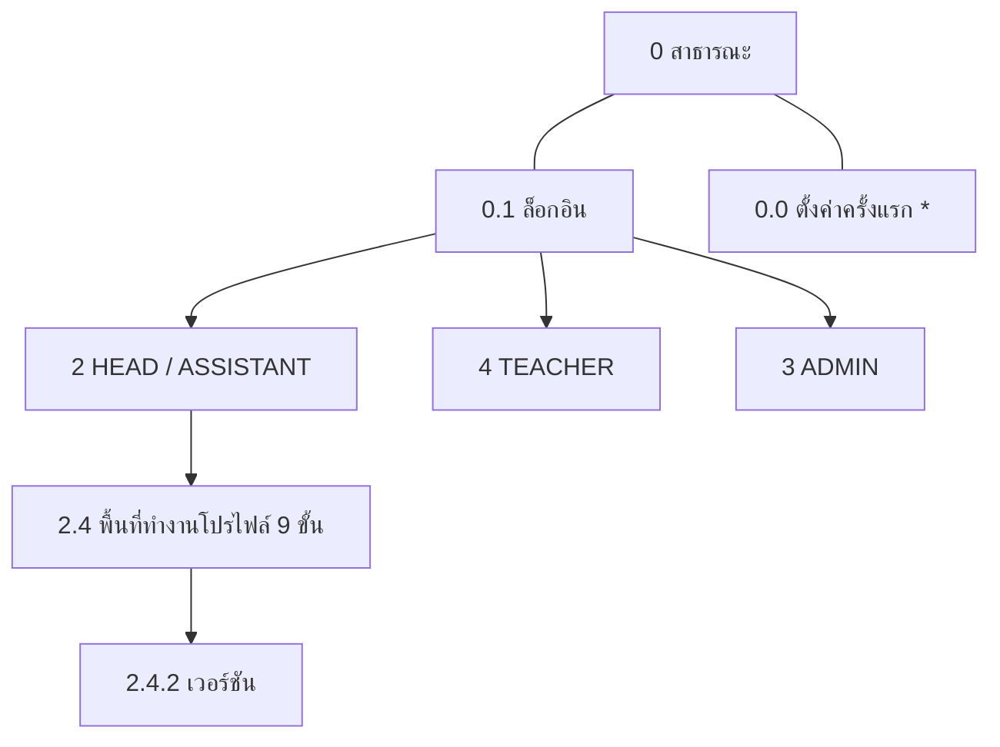
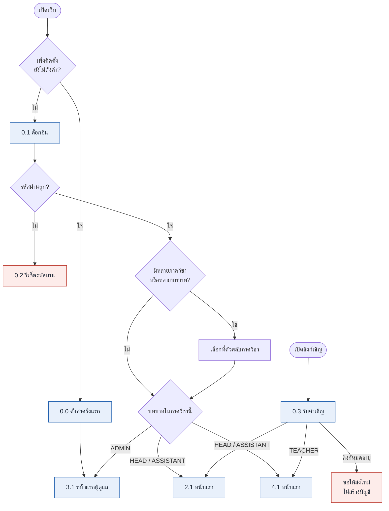

# หน้าและเส้นทาง (Pages and routes)

เรียบเรียงจาก sitemap เลขหน้า (เช่น `2.4`) ตรงกับต้นฉบับ ใช้อ้างอิงข้ามเอกสาร
เส้นทาง URL ด้านล่างเป็น **ข้อเสนอ** (sitemap ไม่ได้กำหนด URL)

สัญลักษณ์: `*` = หน้าใหม่ที่ยังไม่อยู่ในเส้นทางผู้ใช้เดิม

## 1. โครงรวม

ทุกหน้าหลังล็อกอินมีแถบบน: ตัวสลับภาควิชา (ถ้า `is_admin` มีรายการ "ผู้ดูแลสถาบัน" แยก) · กระดิ่ง (1.1) · เมนูบัญชี (1.2)

## 2. สาธารณะ (ยังไม่ล็อกอิน)

| เลข | หน้า | เส้นทางเสนอ | หมายเหตุ |
|---|---|---|---|
| 0.0 * | ตั้งค่าครั้งแรก | `/setup` | แสดง **ครั้งเดียว** หลังติดตั้ง (ชื่อสถาบัน, ผู้ดูแลคนแรก, ภาษา) แล้วหายไป |
| 0.1 | ล็อกอิน | `/login` | |
| 0.2 | ลืม / รีเซ็ตรหัสผ่าน | `/reset` · `/reset/:token` | ไม่มี SMTP: บอกให้ขอลิงก์จากผู้ดูแล/หัวหน้า ผู้ดูแล/หัวหน้าสร้างลิงก์ให้คัดลอกส่งเอง (D12) ร่างหน้า: [wireframes-missing](wireframes-missing.md) |
| 0.3 | รับคำเชิญ | `/invite/:token` | ตั้งรหัสผ่าน หรือเข้าด้วยบัญชีเดิมถ้าอยู่ภาควิชาอื่นแล้ว ลิงก์หมดอายุ → ขอส่งใหม่ |

## 3. ทุกบทบาท

| เลข | หน้า | เส้นทางเสนอ | เนื้อหา |
|---|---|---|---|
| 1.1 * | การแจ้งเตือน | `/notifications` | คำเชิญ กำหนดส่ง การเตือน "แก้โดย <หัวหน้า>: <หมายเหตุ>" เผยแพร่แล้ว |
| 1.2 * | บัญชีของฉัน | `/account` | ชื่อ รหัสผ่าน ภาษา (ไทย/อังกฤษ) ตั้งค่าอีเมล ร่างหน้า: [wireframes-missing](wireframes-missing.md) |

## 4. HEAD / ASSISTANT

| เลข | หน้า | เส้นทางเสนอ | เนื้อหาหลัก | เส้นทาง* |
|---|---|---|---|---|
| 2.1 | หน้าแรก | `/` | ปุ่มใหญ่ "เริ่มตารางเรียนภาคนี้" + สิ่งที่ต้องทำ (อาจารย์ล่าช้า, blocker, คำขอใหม่) | A1 |
| 2.2 | โปรไฟล์ | `/profiles` | รายการ (ชื่อ ภาคเรียน ชั้นปี สถานะ) ปุ่ม ใหม่ / คัดลอกจากภาคก่อน | A2 |
| 2.3 * | บุคลากร & ห้อง | `/people` | อาจารย์ (เชิญ/ลบ) และห้องของภาควิชา อยู่ **นอก** โปรไฟล์ พิมพ์ครั้งเดียวใช้ซ้ำทุกภาค | F12 |
| 2.4 | พื้นที่ทำงานโปรไฟล์ | `/profiles/:id/…` | แถบขั้นตอน 9 ขั้น + แท็บ หลักสูตร×ชั้นปี | A3-A11 |
| 2.4.2 | เวอร์ชัน + บันทึก | `/profiles/:id/versions` | ทุกเวอร์ชัน ใครเปลี่ยนอะไร "เริ่มการเปลี่ยนแปลง" หลังเผยแพร่ | A11-A12 |

\* รหัสขั้นในเส้นทางผู้ใช้ (A1…A12)

### 4.1 ขั้นในพื้นที่ทำงาน 2.4

| ขั้น | หน้า | เส้นทางเสนอ | ทำอะไร | ต่อชั้นปี? | เงื่อนไขไปต่อ |
|---|---|---|---|:-:|---|
| 1 | ตั้งค่า (A3) | `…/setup` | ชื่อ เลือกภาคเรียน (จากปฏิทิน 3.4) อัปโหลดไฟล์ การ์ด "สิ่งที่เราพบ" | | ยืนยันค่าที่ตรวจจับ |
| 1a | ตั้งค่ารูปแบบ 2.4.1 | `…/setup/format` | เฉพาะเมื่อเลย์เอาต์ไม่รู้จัก ชี้คอลัมน์ บันทึกเป็น format definition สถานะ unverified | | |
| 2 | ตรวจข้อมูล (A4) | `…/review` | ตาราง / ผังกระบวนวิชา แผงไฟล์ข้าง "แถวแดงถัดไป" | ✅ | ไม่เหลือแถวแดง |
| 3 | รอบเวลาว่าง (A5) | `…/availability` | เลือกอาจารย์ กำหนดส่ง กระดานสถานะ เตือน | | ทุกคนมีคำตอบ |
| 4 | ข้อมูลอาจารย์ (A6) | `…/issues` | BLOCKER / WARNING + เธรดความเห็น | | ไม่มีรายการที่ยังไม่ตัดสินใจ |
| 5 | กฎ + วิชาเลือก (A7) | `…/rules` | ตารางเวลา กลุ่ม จำนวนห้อง Schedule/Reserve น้ำหนักกฎ Check → รายงาน → Acknowledge | ✅ | acknowledge รายงาน |
| 6 | สร้าง + จัดตาราง (A8) | `…/generate` | Generate ตาราง ถาด ตัวเลือก pin รันใหม่ แท็บย่อย จัดตาราง / พรีวิวพิมพ์ | ✅ | ทุกคาบมีเวลา ไม่ฝ่าฝืนกฎ hard |
| 7 | ห้อง + อาจารย์ (A9) | `…/assign` | ยืนยันห้อง (FET วาง) ยืนยันอาจารย์ต่อคาบ พรีวิว A4 สด | | ทุกคาบมีห้องและอาจารย์ |
| 8 | อาจารย์ตรวจทาน (A10) | `…/review-by-teachers` | ส่งเข้า REVIEW รายการคำขอ + ผลกระทบ direct edit | | |
| 9 | เผยแพร่ + พิมพ์ (A11) | `…/publish` | เผยแพร่ → เวอร์ชันล็อก ดาวน์โหลดต่อกลุ่ม/อาจารย์/ห้อง | | เฉพาะ HEAD |

**กฎแถบขั้น:** ขั้นหนึ่งปลดล็อกเมื่อขั้นก่อนเสร็จ ย้อนไปแก้ขั้นที่เสร็จแล้วจะทำให้ขั้นหลัง **ล้าสมัย** (out of date) และถ้าแก้ในแท็บชั้นปีเดียว จะล้าสมัยเฉพาะชั้นปีนั้น สถานะขั้น: เสร็จ ✓ / ปัจจุบัน / ล้าสมัย ⚠ / ล็อก 🔒 ขั้นล็อกต้องมี tooltip บอกว่าติดอะไร

## 5. ADMIN

| เลข | หน้า | เส้นทางเสนอ | เนื้อหา |
|---|---|---|---|
| 3.1 | หน้าแรกผู้ดูแล | `/admin` | ภาควิชาไหนเผยแพร่แล้ว ไหนล่าช้า มีอัปเดตไหม |
| 3.2 | ภาควิชา + หัวหน้า | `/admin/departments` | สร้างภาควิชา เชิญ/ลบหัวหน้า แสดง "เชิญเมื่อ N วันก่อน" + ส่งอีกครั้ง |
| 3.3 | ห้องร่วม | `/admin/rooms` | ห้องที่หลายภาควิชาใช้ การจองระหว่างภาควิชา |
| 3.4 * | ปฏิทินการศึกษา | `/admin/calendar` | วันที่ภาคเรียนและวันหยุด **วันที่ภาคเรียนมาจากที่นี่เท่านั้น ไม่เอาจากไฟล์หลักสูตร** |
| 3.5 * | รูปแบบหลักสูตร | `/admin/formats` | รูปแบบที่มากับรุ่น + ที่สร้างในที่นี้ อนุมัติ unverified, ส่งออกไปโครงการ |
| 3.6 * | ระบบ | `/admin/system` | สำรอง/กู้คืน SMTP (ไม่บังคับ) เวอร์ชัน สถานะบริการ บันทึกการรัน solver |

## 6. TEACHER

| เลข | หน้า | เส้นทางเสนอ | เนื้อหา |
|---|---|---|---|
| 4.1 | หน้าแรก | `/t` | สิ่งที่ครบกำหนด: กำหนดส่ง รายการเกี่ยวกับฉัน การตรวจทานที่เปิด |
| 4.2 | เวลาว่างของฉัน | `/t/availability` | ตารางไม่ว่างรายสัปดาห์ จัดอันดับวิชา ชั่วโมงสูงสุดต่อวัน แก้ได้จนกำหนด ใบรับ |
| 4.3 | รายการของฉัน | `/t/issues` | blocker/warning เกี่ยวกับฉัน (เธรดความเห็นเดียวกับขั้น 4 ของ HEAD) |
| 4.4 | ตารางของฉัน | `/t/timetable` | เฉพาะคาบของฉัน ติดป้าย DRAFT ใน REVIEW หรือเผยแพร่แล้ว พิมพ์/ดาวน์โหลด "ขอเปลี่ยน" |
| 4.5 | คำขอของฉัน | `/t/requests` | รอ / อนุมัติ / ปฏิเสธ + หมายเหตุ และการเปลี่ยนที่หัวหน้าทำให้ฉัน |

## 7. หน้าที่เชื่อมกัน

| สถานการณ์ | ทางผ่านหน้า |
|---|---|
| ติดตั้ง | `docker compose up` → 0.0 → 3.1 |
| หัวหน้า ภาคใหม่ | 0.1 → 2.1 → 2.2 (คัดลอกจากภาคก่อน) → 2.4 ขั้น 1…9 |
| อาจารย์ใหม่ | 2.3 เชิญ → อีเมล → 0.3 → 4.1 |
| รอบเวลาว่าง | HEAD 2.4(3) เปิดรอบ → TEACHER 1.1 → 4.2 → HEAD ดูสถานะ 2.4(3) |
| รายการปัญหา | HEAD 2.4(4) ↔ TEACHER 4.3 (เธรดเดียวกัน) |
| ตรวจทาน | HEAD 2.4(8) ส่ง → 4.4 → 4.5 ขอ → HEAD อนุมัติ/ปฏิเสธ → 1.1 |
| แก้ตัวต่อตัว | HEAD 2.4(8) direct edit → 1.1 "แก้โดย…" → 4.4 |
| หลังเผยแพร่ | HEAD 2.4.2 "เริ่มการเปลี่ยนแปลง" → เวอร์ชันใหม่ → 1.1 |
| ไฟล์ที่ไม่รู้จัก | HEAD 2.4(1) → 2.4.1 → ADMIN 3.5 อนุมัติ → (ไม่บังคับ) ส่งออกไปโครงการ |

### แผนภาพ: ล็อกอินแล้วไปหน้าไหน

## 8. หน้าตามมือถือ

ตาม design system ระบบออกแบบเดสก์ท็อปก่อน ต่ำกว่า 1024px **อ่านได้เท่านั้น** (ตารางของฉัน, ตอบรอบเวลาว่าง) ไม่รองรับการแก้ตาราง
