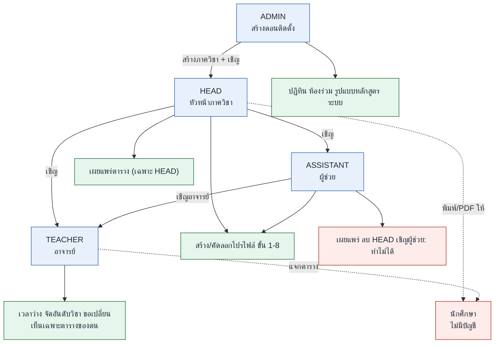

# ข้อกำหนด (Requirements)

เรียบเรียงจาก users-and-goals และ user-journeys

## 1. ปัญหาที่แก้

ตารางเรียนทำด้วยมือใน Excel และกระดาษ ใช้เวลา 3 วันถึง 1 สัปดาห์ต่อภาค ส่วนใหญ่หมดไปกับการที่อาจารย์คุยกันว่าใครสอนได้เมื่อไหร่ และการเปลี่ยนแปลงยังเข้ามาหลังตาราง "สุดท้าย"

## 2. บทบาทและสิทธิ์

| บทบาท | บัญชีสร้างโดย | ขอบเขต |
|---|---|---|
| **ADMIN** ผู้ดูแลสถาบัน | หน้าตั้งค่าครั้งแรกตอนติดตั้ง | ภาควิชา, หัวหน้า, ห้องร่วม, ปฏิทิน, รูปแบบหลักสูตร, ระบบ (สำรองข้อมูล SMTP อัปเดต) |
| **HEAD** หัวหน้าภาควิชา (ผู้ใช้หลัก) | ADMIN เชิญ | ทุกหน้าของภาควิชาตน, เผยแพร่ได้ |
| **ASSISTANT** ผู้ช่วย | HEAD เชิญ (เชิญได้เฉพาะหัวหน้า) | หน้าเดียวกับ HEAD ทำขั้น 1-8 ได้ |
| **TEACHER** อาจารย์ | HEAD หรือ ASSISTANT เชิญ | เวลาว่างของฉัน, รายการของฉัน, ตารางของฉัน, คำขอของฉัน |
| นักศึกษา | ไม่มี | ไม่ใช่ผู้ใช้ ได้รับตารางที่พิมพ์ / PDF จากอาจารย์ |

กฎ:
- คนเดียวมีหลายบทบาทข้ามภาควิชาได้ (เช่น HEAD ที่หนึ่ง TEACHER อีกที่) ผ่านตัวสลับภาควิชา
- หนึ่งบัญชีสังกัดได้หลายภาควิชา
- ADMIN เป็นสิทธิ์ระดับสถาบันติดกับบัญชี (`user.is_admin`) ไม่ใช่สมาชิกภาควิชา บัญชีเดียวเป็น ADMIN และ HEAD/TEACHER พร้อมกันได้ (decisions D12)
- ไม่มีผู้ดูแลแพลตฟอร์มกลาง โครงการโอเพนซอร์สไม่เห็นข้อมูลของสถาบันใดเลย

### เมทริกซ์สิทธิ์

| การกระทำ | ADMIN | HEAD | ASSISTANT | TEACHER |
|---|:-:|:-:|:-:|:-:|
| สร้างภาควิชา / เชิญ HEAD / ห้องร่วม / ปฏิทิน | ✅ | | | |
| อนุมัติรูปแบบหลักสูตรใหม่ | ✅ | | | |
| เชิญอาจารย์ / ผู้ช่วย, จัดการห้องของภาควิชา | | ✅ | ✅* | |
| สร้าง / คัดลอกโปรไฟล์ ทำขั้น 1-8 | | ✅ | ✅ | |
| เผยแพร่ตาราง | | ✅ | ❌ (ขอให้ HEAD) | |
| ลบ HEAD / เชิญผู้ช่วยคนอื่น | | ✅ | ❌ | |
| ส่งเวลาว่าง จัดอันดับวิชา ขอเปลี่ยน | | | | ✅ (เฉพาะของตน) |
| เห็นตารางของทุกคน | | ✅ | ✅ | ❌ เห็นเฉพาะของตน |

\* ผู้ช่วยเชิญอาจารย์ได้หรือไม่ ยังเป็นข้อเสนอ ดู [decisions.md](decisions.md)

### แผนภาพ: ใครเชิญใคร และทำอะไรได้

## 3. เป้าหมาย

### หัวหน้าภาควิชา

| รหัส | เป้าหมาย | วิธีรองรับ |
|---|---|---|
| G1 | ตารางไม่ชนทุกกลุ่ม | FET + pre-check + core lib checker |
| G2 | เร็วกว่า 3 วัน-1 สัปดาห์มาก | รอบเวลาว่างบนเว็บ, FET < 1 วินาที, คัดลอกจากภาคก่อน, ตัวเลือก N แบบ |
| G3 | คุมได้เอง | หน้าจัดตาราง, ตรวจสดตอนวาง, pin + รันใหม่รอบ pin, Schedule/Reserve |
| G4 | เชื่อข้อมูลที่อ่านจากไฟล์ได้ | ทุกค่าลิงก์ไปหน้าต้นทาง, แถวแดงพร้อมเหตุผล |
| G5 | พิมพ์ A4 ดูเป็นทางการ | พรีวิวพิมพ์, ฟอนต์ไทย, ส่งออก PDF |
| G6 | ใช้งานต่อภาคถัดไป | PostgreSQL, profile manager, คัดลอกจากภาคก่อน |

### อื่น ๆ

| รหัส | ผู้ใช้ | เป้าหมาย |
|---|---|---|
| T1 | อาจารย์ | เวลาไม่ว่างและความต้องการได้รับการเคารพ |
| T2 | อาจารย์ | รู้เมื่อมีการเปลี่ยนที่กระทบตน |
| I1 | ADMIN | ภาควิชาไม่จองห้องร่วมซ้ำ |

## 4. ข้อกำหนดที่ห้ามผิด (ต้องเป็นจริงเสมอ)

| รหัส | ห้าม | บังคับด้วย |
|---|---|---|
| N1 | เปลี่ยนตารางโดยผู้ใช้ไม่ได้สั่ง | project service เขียนเพียงตัวเดียว, บันทึกทุกการเปลี่ยน, เก็บเวอร์ชัน |
| N2 | ข้อมูลอาจารย์ออกนอกสถาบัน | ล็อกอิน + บทบาท, self-hosted, PDPA |
| N3 | นักศึกษาเข้าระบบ | ไม่มีบทบาทนักศึกษา ไม่มีลิงก์สาธารณะ |

## 5. ตัวชี้วัดความสำเร็จ

- ทั้งภาคจากไฟล์ถึงพิมพ์ ใช้แรงงาน ≤ 30 นาที (เป้าแรก)
- ตารางที่บันทึกไม่มีการชนแบบ hard
- ทุกคาบถูกจัดลง หรืออยู่ในถาด "ยังไม่ลง" พร้อมเหตุผลและวิธีแก้ใกล้สุด
- ไม่ต้องแก้ไฟล์ด้วยมือ
- วัดในแอป: เวลาต่อขั้น, จำนวนครั้งที่ย้ายด้วยมือ, จำนวนครั้งที่รัน FET, คะแนนคุณภาพ (กฎ soft + คะแนน 1-5 จากหัวหน้า)

## 6. นอกขอบเขตตอนนี้

- นักศึกษาเลือกวิชาเลือกในระบบ (Reserve เก็บเวลาไว้ให้เท่านั้น)
- ตารางสอบ
- ลิงก์สาธารณะสำหรับนักศึกษา (ตัดสินใจแล้ว: ไม่ทำ)

## 7. ความต้องการเชิงฟังก์ชันที่พลาดไม่ได้

ที่มาจากเส้นทางผู้ใช้ เป็นข้อกำหนดที่กระทบการออกแบบโดยตรง:

1. **ตรวจจับก่อน ยืนยันทีหลัง:** ระบบอ่านไฟล์แล้วเติมค่า ผู้ใช้ยืนยันหรือแก้ ทุกค่าแสดงหลักฐาน (หน้า + ข้อความที่จับคู่) เลย์เอาต์ที่ไม่รู้จักห้ามเดาเงียบ ๆ ให้ผู้ใช้ชี้คอลัมน์แล้วบันทึกเป็น format definition
2. **ตรวจเร็ว:** คลิกค่าใดก็ได้ แล้วไฟล์ต้นฉบับเปิดข้างตารางที่หน้านั้นพร้อมไฮไลต์ มีปุ่ม "แถวแดงถัดไป" และไปต่อไม่ได้ตราบที่ยังมีแถวแดง
3. **ปัญหาจากข้อมูลอาจารย์ถูกสร้างโดยระบบ:** BLOCKER ต้องแก้, WARNING แก้หรือ "ยอมรับ + หมายเหตุ" ปิดรายการได้ด้วยการตัดสินใจที่บันทึก (ใคร เมื่อไหร่ ทำไม) ไปต่อได้เมื่อไม่เหลือ BLOCKER และทุก WARNING ถูกตัดสินใจ
4. **Pre-check รายงานต้อง acknowledge** ก่อน Generate ปลดล็อก การรับทราบถูกบันทึกกับการรัน
5. **ผลบางส่วนไม่ใช่ความล้มเหลว:** ตารางบางส่วน + ถาดคาบที่ยังไม่ลง แต่ละคาบมีเหตุผลและวิธีแก้ใกล้สุด
6. **เปลี่ยนน้อยที่สุด:** การอนุมัติคำขอรันใหม่โดยปักหมุดทุกอย่างที่เหลือ และแสดงผลกระทบก่อน ("นี่จะย้ายอีก 2 คาบ")
7. **Direct edit:** ใน REVIEW หัวหน้าแก้บนตารางได้ตรง ๆ พร้อมช่อง "ตกลงกับ ___" แจ้งอาจารย์ที่ได้รับผลกระทบพร้อมเก่า / ใหม่ แก้เล็กที่ไม่กระทบอื่นมีผลทันที แก้ที่ย้ายคาบอื่นต้องถามก่อน หลังเผยแพร่จะสร้างเวอร์ชันใหม่เสมอ
8. **เวลาว่างครั้งเดียวต่อคน** ใช้ร่วมทุกภาควิชา แต่การจัดอันดับวิชาแยกตามภาควิชา HEAD เห็นช่อง "ไม่ว่างที่ภาควิชาอื่น"
